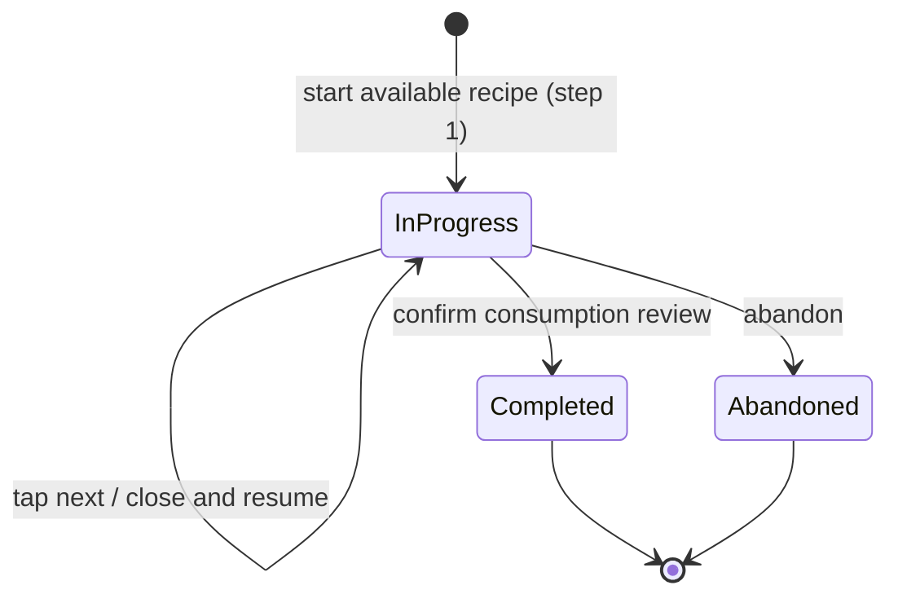

# Domain Model

**Purpose:** define the behavior of the domain independently of screens or code.  
**Schema:** [03-database-design.md](03-database-design.md) implements this model.  
**Vocabulary:** [GLOSSARY.md](../GLOSSARY.md).

> **Superseded for the MVP by docs/06 section 3 (amendments A1-A10);**
> **retained as the MySQL/React contingency record.**

## 1. Core model

| Concept | Responsibility |
|---|---|
| User | Owns exactly one kitchen in v1 and can act only on their own data. |
| Kitchen | Container for stock, selected equipment, and cooking sessions. |
| Ingredient / Unit | Shared catalog and measurement vocabulary; each ingredient has one canonical unit. |
| Stock level + transaction | Current quantity and its auditable change history. |
| Equipment | Closed list of major appliances that can make a recipe impossible. |
| Recipe | Base-yield dish with required equipment, ingredients, and ordered steps. |
| Cooking session | A user’s run through a recipe, including progress and completion. |

A recipe **requires** things; a kitchen **owns** things. Availability is the
match between the two, plus a stock comparison.

## 2. Business rules

| ID | Rule | Enforced by |
|---|---|---|
| R1 | **Ownership.** In v1 a user has at most one kitchen, and a kitchen belongs to exactly one user. All kitchen data is private to that user. | Database unique key and foreign key; API scoping |
| R2 | **Atomic onboarding.** Registering creates the user and kitchen together; a failure creates neither. | API transaction |
| R3 | **Closed catalog.** Ingredients, units, equipment, and recipes are reference data. Users cannot create or rename them in v1. | Seed-only data; no write endpoints |
| R4 | **Canonical units.** Every ingredient has one canonical unit. Stock is stored and compared in that unit. Mass units convert to grams, volume units to millilitres, and count units only match themselves. Dry ingredients are authored by mass; volume units are for liquids. | Foreign keys; API validation; seed validation |
| R5 | **Balance + history.** A stock balance changes only together with an inventory transaction. The ledger is append-only; corrections are new signed adjustments, never edits to history. | API transaction and no ledger edit endpoints; database checks |
| R6 | **Non-negative, unique stock.** A kitchen has at most one stock row per ingredient, and a balance can never be negative. | Database unique/check constraints |
| R7 | **Curated equipment.** Only major appliances whose absence changes what can be cooked are equipment. Gas, electric, and induction stoves are grouped as “stovetop.” Knives, pots, pans, and other replaceable tools are assumed. | Fixed equipment seed; recipe seed |
| R8 | **Availability.** A recipe is available when **every required equipment item is owned** and **every required ingredient has enough stock** at the chosen serving yield. Optional ingredients never block availability. | API availability query |
| R9 | **Linear scaling.** Required quantities scale by `chosen_servings / recipe.servings`. Scaling applies to both display and availability; comparisons use decimal quantities, not rounded labels. | API calculation |
| R10 | **Recipe immutability.** Recipes are seed data and are not editable through the app. A session reads a recipe that cannot change while the session is active. | No recipe write endpoints; seed-only |
| R11 | **Session lifecycle.** A session is `in_progress`, `completed`, or `abandoned`. Only one session per user may be active. A new session may start only for an available recipe. | API rules; database status/step constraints |
| R12 | **Manual steps and advisory timers.** Steps advance only when the cook taps next. A timer is a countdown aid; it never advances a step or deducts stock. Timer state is not persisted. | UI/API |
| R13 | **Consume on confirmation only.** Starting, advancing, or abandoning a session changes no stock. Stock is deducted only when the cook confirms the consumption review. | API transaction |
| R14 | **Atomic completion.** Completion writes all consumption lines, stock balance changes, ledger entries, and the completed session in one transaction. If any ingredient is insufficient, nothing is written. A repeated completion request must not deduct twice. | API transaction and status guard |
| R15 | **Access scope.** A user can read or change only their own kitchen, sessions, stock, and history. Requests for another user’s resources are rejected without revealing whether they exist. | API authorization by session/kitchen owner |
| R16 | **No destructive UI.** The MVP does not expose deleting users, kitchens, or catalog data. Database delete actions are defined for data hygiene and future tools. | Database foreign-key actions; no delete endpoints |

## 3. Availability rule

For a kitchen `K`, recipe `R`, and chosen servings `S`:

```
available(R, K, S) ⇔
  required_equipment(R) ⊆ owned_equipment(K)
  AND for every required ingredient ri of R:
      stock(K, ri.ingredient) ≥
        ri.quantity × (ri.unit_factor_to_base / canonical_unit_factor)
                   × (S / R.servings)
```

Rules:

- **Required equipment** is a subset test. A recipe needing stovetop + oven
  requires both. Extra equipment in the kitchen is irrelevant.
- **Required ingredients** are checked individually. A missing stock row is
  treated as zero.
- **Optional ingredients** are omitted from the availability test entirely.
- **Count units** must match the ingredient’s canonical count unit; `pc` is not
  interchangeable with `clove`.
- **Scale before comparing.** A recipe for 4 servings cooked at 2 servings needs
  half of each required quantity.
- **No rounding in the comparison.** `“Buy 1 onion”` may round for display, but
  availability uses the exact decimal.
- **Missing requirements** are returned separately so the UI can explain
  *why* a recipe is unavailable. They do not include optional items.

The app computes availability on every read. It never stores a “cookable” flag,
because stock and equipment change independently of recipes.

## 4. Stock rules

### Reasons and signs

| Reason | Sign | Meaning |
|---|---|---|
| `initial` | positive | First recorded stock for this kitchen and ingredient. |
| `restock` | positive | Additional stock bought or received. |
| `consume` | negative | Used in cooking or quick consumption. May link to a session. |
| `waste` | negative | Spoiled, spilled, or discarded. |
| `adjustment` | either | Correction after a count, with a non-zero delta. |

No transaction has a zero delta. Ledger rows are never updated or deleted
during normal operation.

### Adding, correcting, and using stock

1. The user picks an ingredient and enters a quantity and unit.
2. The API converts the input to the ingredient’s canonical unit. Conversion is
   allowed only within mass or within volume. Count units must be identical.
3. **Add:** current balance increases; reason is `initial` for the first row,
   otherwise `restock`.
4. **Set/correct:** the API computes `target − current`; a positive or negative
   adjustment is recorded. A no-op correction is rejected rather than writing a
   zero transaction.
5. **Quick consume:** current balance decreases; reason is `consume`, with no
   session link. The amount cannot exceed the balance.
6. Balance update and ledger insert happen in one database transaction.
7. The new balance cannot be negative. If the requested operation would make it
   negative, the API rejects it and shows the available amount.

A reconciliation query can always check that each balance equals the sum of its
transactions; the detailed query is in
[03-database-design.md](03-database-design.md#74-reconciliation-check).

## 5. Guided cooking lifecycle



### Start

- The recipe must be available for the requested servings.
- The user must not already have an active session. If one exists, the API
  returns it so the client can offer “Resume” or “Abandon.”
- The session stores the user, kitchen, recipe, chosen servings, start time, and
  `current_step_number = 1`.
- **No stock is reserved or deducted.**

### Steps and timers

- Steps are linear and numbered `1..N`.
- Tapping next moves to `current_step + 1`, up to `N`.
- At step `N`, the client opens the consumption review; the session is still
  `in_progress` until confirmation.
- A step with a duration shows a countdown. The user may tap next before or
  after it ends; the timer is advisory.
- Closing the app does not advance or complete the session. Reopening returns
  the current step and does not restore a running timer.

### Completion review

- Every recipe ingredient is listed with an editable amount.
- Default amounts are the scaled recipe estimates. If the kitchen has no stock
  for an ingredient, its default is `0` and it is flagged. If stock exists but
  is below the estimate, the estimate is still shown and the line is flagged;
  confirmation blocks until the cook edits it.
- Optional items are included so cooks can record their use; they are editable
  and can be set to zero.
- The cook can set any line to zero; a zero amount writes no transaction for
  that ingredient.
- The actual amount cannot exceed the current stock at confirmation.
- The client shows a summary of the total stock after deduction and asks for
  confirmation.

### Completion transaction

The API must, in one transaction:

1. Lock the session row and verify it belongs to the user and is `in_progress`.
2. Verify the session is at the final step.
3. Lock each affected stock row, re-read balances, and validate the actual
   amounts supplied.
4. Decrease each balance and insert a `consume` transaction linked to the
   session.
5. Mark the session `completed` with `completed_at`.
6. Commit; any validation failure rolls everything back.

A second completion request for the same session returns a conflict and never
deducts twice.

### Abandon

Abandoning marks the session `abandoned`. It writes no stock transactions.
Completed sessions cannot be abandoned.

## 6. Edge cases

| Case | Behavior |
|---|---|
| Stock exactly equals the scaled requirement | Available; the comparison is `≥`. |
| No stock row exists | Treated as zero; required ingredient is missing. |
| Optional ingredient is out of stock | Recipe remains available; review shows 0. |
| Count unit mismatched (`pc` vs `clove`) | Rejected by seed validation for recipes; runtime input is restricted to the canonical count unit. |
| Recipe unavailable when starting | Start is rejected with the missing requirements. |
| Stock drops while a session is in progress | Completion revalidates actual amounts; it does not require the original estimate to still be available. |
| Actual amount exceeds available stock | Completion is rejected with a 409-style shortage response; nothing is written. |
| Repeated completion request | Rejected because the session is no longer `in_progress`; no double deduction. |
| Session abandoned | No stock change; history records abandonment. |
| App closed during a timer | Session stays on the same step; timer is not persisted. |
| Second active session attempted | Rejected; the existing active session is returned. |
| Another user’s session ID is requested | Not found/denied; no data leak. |
| No equipment selected | Equipment-dependent recipes are unavailable; UI links to kitchen setup. |
| User edits equipment mid-cook | Does not alter an active session; it may affect future availability checks. |
| Recipe edited after a session starts (future) | Impossible in v1 because recipes are immutable seed data. |
| Referenced catalog row deleted | Restricted by the database; no delete UI exists. |

## 7. Deliberate omissions

These are not bugs; they are v1 choices with known consequences:

- **Water is not tracked.** Steps may call for water, but it is assumed available
  and does not affect availability.
- **No density conversions.** Mass and volume are not converted into each other.
- **No raw/cooked equivalence.** Ingredients are stocked as authored. Sinangag
  uses raw rice and includes a rice-cooking prep step rather than tracking
  “cooked rice” separately.
- **No stock reservations.** A session reserves nothing; stock can be used by
  another action until completion.
- **No per-step completion log.** Only the current step is stored. Timers and
  step durations are not part of history.
- **No recipe versioning.** Recipes cannot change. If they become editable,
  sessions will need a recipe snapshot or version reference.
- **No batches, expiry, or locations.** Each kitchen/ingredient has one balance.
- **No substitutions.** A missing ingredient cannot be replaced by another in
  availability.

## 8. Future model

Designed-for extensions, not built in v1:

- **Multiple kitchens and sharing:** drop the one-kitchen unique rule; add a
  kitchen membership entity with owner/editor/viewer roles; authorize by
  membership rather than ownership. See
  [03-database-design.md](03-database-design.md#11-future-multiple-kitchens-and-sharing).
- **Substitutions:** relate a recipe ingredient to possible substitute
  ingredients and ratios; availability would treat a satisfied substitute as
  satisfying the requirement.
- **Custom ingredients and recipes:** user-owned catalog rows need ownership and
  moderation rules.
- **Batches/expiry:** replace the single balance with stock lots while retaining
  an aggregate balance.
- **Recipe versioning:** store the recipe/step version used by a session.
- **Step-level progress:** record completed steps and timer use for richer
  history.
- **Shopping list:** derive needed quantities from unavailable recipes and
  current stock.

## 9. Decision log

| Decision | Alternative rejected | Why |
|---|---|---|
| Kitchen is its own entity | Put kitchen fields on the user record | Keeps the door open for multiple/shared kitchens without reshaping stock ownership. |
| One kitchen per user now, with a unique key | Allow many kitchens immediately | Matches the MVP and prevents untested sharing rules. |
| Canonical units per ingredient | Free-form units per stock row | Makes comparison unambiguous and prevents accidental unit mixing. |
| Restrict conversions to mass/volume and exact counts | Convert everything through a generic factor | Avoids density guesses and meaningless `pc ↔ clove` conversions. |
| Balance plus append-only ledger | Only a mutable balance, or only ledger sums | Balance makes reads simple; ledger makes history and reconciliation possible. |
| Availability computed live | Store a `can_cook` column | Stock, equipment, and servings change independently; a stored flag would go stale. |
| Curated five-item equipment list | Track every kitchen tool | Recipes only fail for appliances that materially change the dish; tools are assumed. |
| Stock deducted at completion | Deduct/reserve at session start | Abandoned or interrupted cooks should not silently drain inventory. |
| Optional ingredients ignored for availability | Require all seasonings and garnishes | Prevents false negatives for pantry basics while still recording actual use. |
| One active session per user | Allow several concurrent sessions | Simpler stock-confirmation and UI; matches how one person cooks. |
| No per-step server log | Persist every step completion | Not needed for the MVP; current step is enough to resume. |
