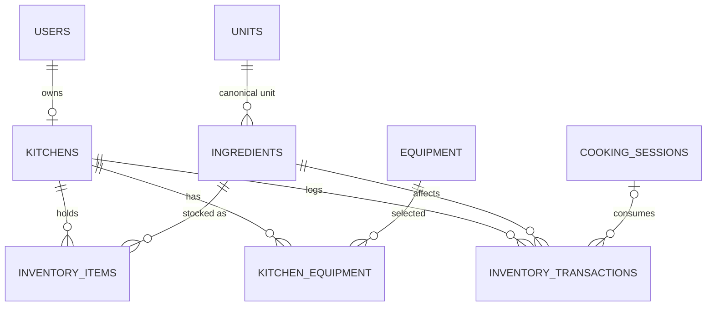
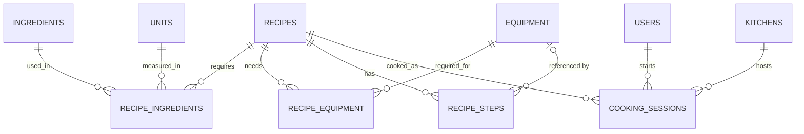

# Database Design

**Target:** MySQL 8.0.16 or newer (CHECK constraints are enforced from 8.0.16).  
**Database name:** `kusina`  
**Schema file:** [`db/schema.sql`](../db/schema.sql) — validated against MySQL 9.7.2.  
**Domain rules:** [02-domain-model.md](02-domain-model.md).

> **Superseded for the MVP by docs/06 section 3 (amendments A1-A10);**
> **retained as the MySQL/React contingency record.**

## 1. Design goals

- Represent stock as both a usable current balance and an auditable history.
- Keep recipe requirements, equipment, and units in normalized reference tables.
- Make availability a query, not a stored flag that can drift.
- Enforce every invariant that MySQL can enforce at the database level.
- Leave a documented path to multiple kitchens and sharing without building it now.
- Keep the schema small enough for a class project: **13 tables**.

## 2. Schema at a glance

| Group | Tables |
|---|---|
| Accounts | `users`, `kitchens` |
| Reference data | `units`, `ingredients`, `equipment` |
| Stock | `inventory_items`, `inventory_transactions`, `kitchen_equipment` |
| Recipes | `recipes`, `recipe_ingredients`, `recipe_equipment`, `recipe_steps` |
| Cooking | `cooking_sessions` |

**Conventions**

- Tables and columns use `snake_case`; tables are plural.
- Surrogate `BIGINT UNSIGNED` primary keys except junction tables, which use
  composite primary keys.
- Quantities are `DECIMAL(12, 3)`; conversion factors are
  `DECIMAL(18, 6)`. No floating-point values are used for stock.
- Timestamps use `TIMESTAMP`. Created rows default to the current time;
  mutable tables also have `updated_at`.
- All tables are InnoDB with `utf8mb4_unicode_ci`.
- Constraint prefixes: `uq_` unique, `ck_` check, `fk_` foreign key, `idx_`
  non-unique index.
- Database name and object names are fixed. Import steps are in
  [README.md](../README.md#database-quick-start).

**Current schema statistics:** 13 tables, 19 foreign keys, 12 CHECK
constraints, 24 indexes beyond primary keys.

## 3. Entity-relationship diagram

The relationships are split into two diagrams for readability. The full column
list is in section 4.

### Accounts and stock



### Recipes and cooking



The stock diagram includes `inventory_transactions.cooking_session_id`; the
recipe diagram includes the session itself. The two diagrams overlap only at
that link.

### Cardinality notes

- A user has **zero or one** kitchen in v1. A kitchen has exactly one owner.
- A kitchen has zero or more stock rows and selected equipment.
- Each stock row belongs to exactly one kitchen and one catalog ingredient.
- A recipe has at least one ingredient and one step; v1 seed validation enforces
  this. Recipe equipment may be empty only if a recipe truly needs no appliance.
- A cooking session belongs to one user, one kitchen, and one recipe.
- A cooking session has zero or more consumption transactions. Abandoned or
  not-yet-completed sessions have none.

## 4. Data dictionary

The dictionary is grouped logically. Physical table order in `schema.sql` is
adjusted so foreign keys reference already-created tables.

### 4.1 `users`

Account records. One row per person.

| Column | Type | Constraints / default | Notes |
|---|---|---|---|
| `id` | BIGINT UNSIGNED | PK, auto-increment | |
| `email` | VARCHAR(255) | NOT NULL, UNIQUE | Stored lowercase by the API; unique under the case-insensitive collation. |
| `password_hash` | VARCHAR(255) | NOT NULL | Password hash only; never plaintext. |
| `display_name` | VARCHAR(100) | NOT NULL | |
| `created_at` | TIMESTAMP | NOT NULL, default current timestamp | |
| `updated_at` | TIMESTAMP | NOT NULL, current timestamp on update | |

No delete endpoint exists. Deleting a user manually cascades to their kitchen
and sessions.

### 4.2 `kitchens`

The stock/equipment container. In v1, one per user.

| Column | Type | Constraints / default | Notes |
|---|---|---|---|
| `id` | BIGINT UNSIGNED | PK, auto-increment | |
| `owner_user_id` | BIGINT UNSIGNED | NOT NULL, UNIQUE, FK → `users.id` | The unique key enforces one kitchen per user. Delete cascades. |
| `name` | VARCHAR(100) | NOT NULL, default `'My Kitchen'` | User-editable label. |
| `created_at` | TIMESTAMP | NOT NULL, default current timestamp | |
| `updated_at` | TIMESTAMP | NOT NULL, current timestamp on update | |

The application creates the kitchen in the same transaction as registration.
The future way to allow more kitchens is to drop the unique index and add a
membership table (section 11); stock is already keyed by kitchen.

### 4.3 `units`

Measurement vocabulary and conversion factors.

| Column | Type | Constraints / default | Notes |
|---|---|---|---|
| `id` | BIGINT UNSIGNED | PK, auto-increment | |
| `code` | VARCHAR(10) | NOT NULL, UNIQUE | Stable seed identifier: `g`, `kg`, `ml`, `l`, `tsp`, `tbsp`, `cup`, `pc`, `clove`. |
| `name` | VARCHAR(30) | NOT NULL | Display name. |
| `dimension` | ENUM(`mass`, `volume`, `count`) | NOT NULL | Conversion group. |
| `factor_to_base` | DECIMAL(18, 6) | NOT NULL, CHECK > 0 | Mass → grams; volume → millilitres; count → whole units. |

Conversion rule: mass and volume units convert within their own dimension.
Count units are only compatible when the unit is identical (`pc` ≠ `clove`).
Volume units are intended for liquids; dry ingredients are authored by mass.

### 4.4 `ingredients`

Shared food/seasoning catalog.

| Column | Type | Constraints / default | Notes |
|---|---|---|---|
| `id` | BIGINT UNSIGNED | PK, auto-increment | |
| `name` | VARCHAR(100) | NOT NULL, UNIQUE | Common lowercase name; unique case-insensitively. |
| `category` | ENUM(`produce`, `meat`, `seafood`, `dairy_eggs`, `pantry`, `condiments`, `spices`) | NOT NULL | Fixed v1 taxonomy. |
| `canonical_unit_id` | BIGINT UNSIGNED | NOT NULL, FK → `units.id` | Stock for this ingredient is always in this unit. Delete restricted. |
| `created_at` | TIMESTAMP | NOT NULL, default current timestamp | |

No user-created ingredients in v1. Each ingredient's canonical unit is chosen
once; recipe units must be compatible with it. That cross-table rule is checked
by a seed validation query (section 8 of
[04-seed-data-plan.md](04-seed-data-plan.md#8-validation-queries)) because a
MySQL CHECK cannot reference another table.

### 4.5 `equipment`

Closed list of major appliances.

| Column | Type | Constraints / default | Notes |
|---|---|---|---|
| `id` | BIGINT UNSIGNED | PK, auto-increment | |
| `code` | VARCHAR(30) | NOT NULL, UNIQUE | `stovetop`, `oven`, `air_fryer`, `grill`, `pressure_cooker`. |
| `name` | VARCHAR(60) | NOT NULL, UNIQUE | Display name. |
| `description` | VARCHAR(255) | NULL | Onboarding help text. |

Every equipment row is required by at least one seeded recipe; the seed
validation checks this. Basic tools are not represented.

### 4.6 `inventory_items`

Current stock balance per kitchen and ingredient.

| Column | Type | Constraints / default | Notes |
|---|---|---|---|
| `id` | BIGINT UNSIGNED | PK, auto-increment | |
| `kitchen_id` | BIGINT UNSIGNED | NOT NULL, FK → `kitchens.id` | Delete cascades with the kitchen. |
| `ingredient_id` | BIGINT UNSIGNED | NOT NULL, FK → `ingredients.id` | Delete restricted. |
| `quantity` | DECIMAL(12, 3) | NOT NULL, default 0, CHECK ≥ 0 | In the ingredient's canonical unit. This is a materialized balance. |
| `created_at` | TIMESTAMP | NOT NULL, default current timestamp | |
| `updated_at` | TIMESTAMP | NOT NULL, current timestamp on update | |

`UNIQUE (kitchen_id, ingredient_id)` prevents duplicate stock rows. A row at
zero is retained for history. The balance is always written together with a
ledger row, and the ledger is the audit source.

### 4.7 `kitchen_equipment`

Many-to-many selection of appliances owned by a kitchen.

| Column | Type | Constraints / default | Notes |
|---|---|---|---|
| `kitchen_id` | BIGINT UNSIGNED | PK part, FK → `kitchens.id` | Delete cascades. |
| `equipment_id` | BIGINT UNSIGNED | PK part, FK → `equipment.id` | Delete restricted. |
| `created_at` | TIMESTAMP | NOT NULL, default current timestamp | When it was selected. |

Composite primary key `(kitchen_id, equipment_id)` prevents duplicates. The
index on `equipment_id` supports reverse lookups.

### 4.8 `inventory_transactions`

Append-only stock history. One row per stock change.

| Column | Type | Constraints / default | Notes |
|---|---|---|---|
| `id` | BIGINT UNSIGNED | PK, auto-increment | |
| `kitchen_id` | BIGINT UNSIGNED | NOT NULL, FK → `kitchens.id` | Delete cascades with the kitchen. |
| `ingredient_id` | BIGINT UNSIGNED | NOT NULL, FK → `ingredients.id` | Delete restricted. |
| `quantity_delta` | DECIMAL(12, 3) | NOT NULL, CHECK ≠ 0 | Signed; in the ingredient's canonical unit. |
| `reason` | ENUM(`initial`, `restock`, `consume`, `waste`, `adjustment`) | NOT NULL | Determines allowed sign. |
| `cooking_session_id` | BIGINT UNSIGNED | NULL, FK → `cooking_sessions.id` | Delete sets NULL. Only consumption should link a session; see below. |
| `note` | VARCHAR(255) | NULL | Optional context. |
| `created_at` | TIMESTAMP | NOT NULL, default current timestamp | |

CHECK constraints:

- `quantity_delta <> 0`
- `initial` / `restock` → delta > 0
- `consume` / `waste` → delta < 0
- `adjustment` → any non-zero delta

Secondary indexes: `(kitchen_id, created_at)`, `(ingredient_id)`,
`(cooking_session_id)`.

**Application-enforced:** a session link is allowed only for `consume`, and the
session's kitchen must match `kitchen_id`. MySQL rejected a CHECK combining
`cooking_session_id` with the `ON DELETE SET NULL` foreign key
(`ERROR 3823`), so the link rule cannot be a simple CHECK. This was verified
during schema testing; the API and completion transaction enforce it.

### 4.9 `recipes`

Seed dish definitions with base yield.

| Column | Type | Constraints / default | Notes |
|---|---|---|---|
| `id` | BIGINT UNSIGNED | PK, auto-increment | |
| `name` | VARCHAR(150) | NOT NULL, UNIQUE | Display name. |
| `slug` | VARCHAR(160) | NOT NULL, UNIQUE | URL-safe stable identifier. |
| `description` | TEXT | NULL | Short description. |
| `cuisine` | VARCHAR(50) | NOT NULL, default `'Filipino'` | Keeps future non-local recipes possible. |
| `servings` | SMALLINT UNSIGNED | NOT NULL, CHECK > 0 | Base yield for the ingredient quantities. |
| `prep_minutes` | SMALLINT UNSIGNED | NULL | Informational. |
| `cook_minutes` | SMALLINT UNSIGNED | NULL | Informational. |
| `difficulty` | ENUM(`easy`, `medium`, `hard`) | NOT NULL, default `'easy'` | Informational. |
| `created_at` | TIMESTAMP | NOT NULL, default current timestamp | |
| `updated_at` | TIMESTAMP | NOT NULL, current timestamp on update | |

No recipe image, publish flag, author, or version in v1. Recipes are immutable
seed data and there are no write endpoints.

### 4.10 `recipe_ingredients`

Required and optional ingredients at the recipe's base yield.

| Column | Type | Constraints / default | Notes |
|---|---|---|---|
| `recipe_id` | BIGINT UNSIGNED | PK part, FK → `recipes.id` | Delete cascades. |
| `ingredient_id` | BIGINT UNSIGNED | PK part, FK → `ingredients.id` | Delete restricted. |
| `quantity` | DECIMAL(12, 3) | NOT NULL, CHECK > 0 | Base-yield quantity. |
| `unit_id` | BIGINT UNSIGNED | NOT NULL, FK → `units.id` | Must be dimension-compatible with the ingredient's canonical unit. Delete restricted. |
| `is_optional` | BOOLEAN | NOT NULL, default FALSE, CHECK IN (0, 1) | Optional items do not affect availability. |
| `preparation_note` | VARCHAR(120) | NULL | For example, “crushed” or “cut into pieces.” |

Composite primary key `(recipe_id, ingredient_id)` means an ingredient appears
once per recipe; combine quantities and put preparation in the note. Indexes on
`ingredient_id` and `unit_id` support reverse lookups and validation.

The unit compatibility rule is not enforceable by a plain FK/CHECK because it
spans `recipe_ingredients` and `ingredients`; the seed validation query rejects
incompatible rows.

### 4.11 `recipe_equipment`

Equipment without which the recipe cannot be cooked. At least one appliance is
expected for every seed recipe; the seed validation checks that every catalog
appliance is used by at least one recipe.

| Column | Type | Constraints / default | Notes |
|---|---|---|---|
| `recipe_id` | BIGINT UNSIGNED | PK part, FK → `recipes.id` | Delete cascades. |
| `equipment_id` | BIGINT UNSIGNED | PK part, FK → `equipment.id` | Delete restricted. |

Every row is a hard requirement. Optional conveniences are deliberately not
represented. `recipe_steps.equipment_id` may point to an appliance only as a UI
hint; the seed validation requires that hint to also appear here.

### 4.12 `recipe_steps`

Ordered guided instructions.

| Column | Type | Constraints / default | Notes |
|---|---|---|---|
| `id` | BIGINT UNSIGNED | PK, auto-increment | |
| `recipe_id` | BIGINT UNSIGNED | NOT NULL, FK → `recipes.id` | Delete cascades. |
| `step_number` | SMALLINT UNSIGNED | NOT NULL, CHECK > 0 | Unique within a recipe. |
| `instruction` | TEXT | NOT NULL | Imperative step text. |
| `duration_seconds` | INT UNSIGNED | NULL, CHECK > 0 if present | Non-null means the UI offers a countdown timer. |
| `equipment_id` | BIGINT UNSIGNED | NULL, FK → `equipment.id` | Optional UI hint. Delete restricted. |

`UNIQUE (recipe_id, step_number)` prevents duplicate step numbers. The
contiguous `1..N` sequence is a seed invariant checked with `ROW_NUMBER()`
because a CHECK cannot span rows.

### 4.13 `cooking_sessions`

One guided cook of one recipe.

| Column | Type | Constraints / default | Notes |
|---|---|---|---|
| `id` | BIGINT UNSIGNED | PK, auto-increment | |
| `user_id` | BIGINT UNSIGNED | NOT NULL, FK → `users.id` | Delete cascades. Captures who cooked. |
| `kitchen_id` | BIGINT UNSIGNED | NOT NULL, FK → `kitchens.id` | Delete cascades. |
| `recipe_id` | BIGINT UNSIGNED | NOT NULL, FK → `recipes.id` | Delete restricted; history is preserved. |
| `servings` | SMALLINT UNSIGNED | NOT NULL, CHECK > 0 | Chosen yield; may differ from `recipes.servings`. |
| `status` | ENUM(`in_progress`, `completed`, `abandoned`) | NOT NULL, default `'in_progress'` | |
| `current_step_number` | SMALLINT UNSIGNED | NOT NULL, default 1, CHECK ≥ 1 | Last step shown. Value is 1..N; range is app-enforced. |
| `started_at` | TIMESTAMP | NOT NULL, default current timestamp | |
| `completed_at` | TIMESTAMP | NULL | Required exactly when status is `completed` (CHECK). |
| `updated_at` | TIMESTAMP | NOT NULL, current timestamp on update | |

The CHECK ensures `completed_at` is set only for completed sessions and is
non-null for them. Indexes: `(user_id, status)`, `(kitchen_id)`, `(recipe_id)`.

**Application-enforced:** one active session per user, user/kitchen ownership
match, current step within the recipe's step count, and no duplicate completion.

## 5. Foreign keys and delete policy

| Parent → child | Cardinality | Delete action | Why |
|---|---|---|---|
| `users` → `kitchens` | 1 → 0..1 | CASCADE | Account removal removes its kitchen. |
| `users` → `cooking_sessions` | 1 → 0..* | CASCADE | Sessions are user-owned history. |
| `kitchens` → `inventory_items` | 1 → 0..* | CASCADE | Stock cannot outlive its kitchen. |
| `kitchens` → `kitchen_equipment` | 1 → 0..* | CASCADE | Equipment selections belong to the kitchen. |
| `kitchens` → `inventory_transactions` | 1 → 0..* | CASCADE | Stock history belongs to the kitchen. |
| `kitchens` → `cooking_sessions` | 1 → 0..* | CASCADE | Cooking history belongs to the kitchen. |
| `cooking_sessions` → `inventory_transactions` | 0..1 → 0..* | SET NULL | Keep the ledger row if a session is removed. |
| `ingredients` → `inventory_items` | 1 → 0..* | RESTRICT | Prevent orphaning stock. |
| `ingredients` → `recipe_ingredients` | 1 → 0..* | RESTRICT | Prevent incomplete recipes. |
| `ingredients` → `inventory_transactions` | 1 → 0..* | RESTRICT | Preserve stock history. |
| `units` → `ingredients` | 1 → 0..* | RESTRICT | A unit in use cannot vanish. |
| `units` → `recipe_ingredients` | 1 → 0..* | RESTRICT | |
| `equipment` → `kitchen_equipment` | 1 → 0..* | RESTRICT | |
| `equipment` → `recipe_equipment` | 1 → 0..* | RESTRICT | |
| `equipment` → `recipe_steps` | 1 → 0..* | RESTRICT | |
| `recipes` → `recipe_ingredients` | 1 → 0..* | CASCADE | Recipe-owned child rows. |
| `recipes` → `recipe_equipment` | 1 → 0..* | CASCADE | |
| `recipes` → `recipe_steps` | 1 → 0..* | CASCADE | |
| `recipes` → `cooking_sessions` | 1 → 0..* | RESTRICT | Preserve cooking history. |

There is no destructive UI in the MVP. These actions define what a manual
administrative delete would do. User deletion cascades and session-link
`SET NULL` were both tested.

## 6. Database-enforced vs application-enforced rules

| Invariant | Enforced by |
|---|---|
| One kitchen per user | `UNIQUE (kitchens.owner_user_id)` |
| Unique stock row per kitchen/ingredient | `UNIQUE (kitchen_id, ingredient_id)` |
| No negative stock | `CHECK (quantity >= 0)` |
| Ledger signs match reasons | `CHECK` reason/sign combination |
| Non-zero ledger entries | `CHECK (quantity_delta <> 0)` |
| Completed timestamp consistency | `CHECK` on status/`completed_at` |
| Recipe/step numbering uniqueness | `UNIQUE (recipe_id, step_number)` |
| Positive quantities, servings, durations | `CHECK` constraints |
| Balance equals ledger sum | API transaction + reconciliation test (not a DB constraint) |
| Stock written with a ledger row | API transaction |
| Ledger append-only | API design; databases do not forbid updates |
| Unit dimension compatibility | Seed validation; API input validation |
| Contiguous step numbers | Seed validation (`ROW_NUMBER()`) |
| Every recipe has required ingredients and steps | Seed validation |
| Every equipment item is used | Seed validation |
| Step equipment hint ⊆ recipe equipment | Seed validation |
| One active session per user | API check (not a simple partial unique key) |
| Session/user/kitchen ownership | API authorization |
| Transaction session uses same kitchen and reason `consume` | API transaction |
| Completion at final step, once | API transaction and status guard |
| Availability and missing requirements | Live SQL query |
| Recipe immutability | Seed-only data and no write endpoints |

MySQL version note: CHECK constraints are parsed but **not enforced** by MySQL
versions before 8.0.16. If the school server runs an older MySQL, the API must
duplicate those checks.

## 7. Key queries and transaction patterns

### 7.1 Availability query

Parameter order: `kitchen_id`, `kitchen_id`, `servings`. This query was run
against fixture data for equipment filtering, serving scaling, mass conversion,
optional ingredients, and shortages.

```sql
SELECT r.id, r.slug, r.name
FROM recipes r
WHERE NOT EXISTS (
    -- Missing required equipment
    SELECT 1
    FROM recipe_equipment req
    LEFT JOIN kitchen_equipment ke
      ON ke.equipment_id = req.equipment_id
     AND ke.kitchen_id = ?                        -- param 1: kitchen
    WHERE req.recipe_id = r.id
      AND ke.kitchen_id IS NULL
)
AND NOT EXISTS (
    -- Missing or insufficient required ingredient
    SELECT 1
    FROM recipe_ingredients ri
    JOIN ingredients i ON i.id = ri.ingredient_id
    JOIN units ru ON ru.id = ri.unit_id
    JOIN units cu ON cu.id = i.canonical_unit_id
    LEFT JOIN inventory_items ii
      ON ii.kitchen_id = ?                        -- param 2: kitchen
     AND ii.ingredient_id = ri.ingredient_id
    WHERE ri.recipe_id = r.id
      AND ri.is_optional = 0
      AND (
          (ru.dimension IN ('mass', 'volume') AND ru.dimension = cu.dimension)
          OR (ru.dimension = 'count' AND ru.id = cu.id)
      )
      AND COALESCE(ii.quantity, 0) <
          ri.quantity
          * (ru.factor_to_base / cu.factor_to_base)
          * (? / r.servings)                      -- param 3: servings
)
ORDER BY r.name;
```

The unit-compatibility predicate is defensive; seed validation should already
guarantee it. `COALESCE` treats a missing stock row as zero. The comparison is
`<`, so equality is sufficient.

### 7.2 Missing equipment for a recipe

```sql
SELECT e.code AS missing_equipment
FROM recipe_equipment req
JOIN equipment e ON e.id = req.equipment_id
WHERE req.recipe_id = ?
  AND NOT EXISTS (
      SELECT 1
      FROM kitchen_equipment ke
      WHERE ke.kitchen_id = ?
        AND ke.equipment_id = req.equipment_id
  );
```

### 7.3 Missing required ingredients for a recipe

```sql
SELECT
    i.name AS ingredient,
    ri.quantity * (ru.factor_to_base / cu.factor_to_base)
        * (? / r.servings) AS required_qty,
    COALESCE(ii.quantity, 0) AS available_qty,
    GREATEST(
        ri.quantity * (ru.factor_to_base / cu.factor_to_base)
            * (? / r.servings) - COALESCE(ii.quantity, 0),
        0
    ) AS shortage
FROM recipe_ingredients ri
JOIN recipes r ON r.id = ri.recipe_id
JOIN ingredients i ON i.id = ri.ingredient_id
JOIN units ru ON ru.id = ri.unit_id
JOIN units cu ON cu.id = i.canonical_unit_id
LEFT JOIN inventory_items ii
  ON ii.kitchen_id = ?
 AND ii.ingredient_id = ri.ingredient_id
WHERE ri.recipe_id = ?
  AND ri.is_optional = 0
HAVING shortage > 0
ORDER BY i.name;
```

Parameter order: `servings`, `servings`, `kitchen_id`, `recipe_id`.

### 7.4 Reconciliation check

This should return no rows in normal operation:

```sql
SELECT
    ii.kitchen_id,
    ii.ingredient_id,
    ii.quantity AS current_balance,
    COALESCE(SUM(it.quantity_delta), 0) AS ledger_total
FROM inventory_items ii
LEFT JOIN inventory_transactions it
  ON it.kitchen_id = ii.kitchen_id
 AND it.ingredient_id = ii.ingredient_id
GROUP BY ii.kitchen_id, ii.ingredient_id, ii.quantity
HAVING ii.quantity <> COALESCE(SUM(it.quantity_delta), 0);
```

The app writes both sides in one transaction. This query is the invariant test
and a diagnostic tool, not a scheduled job. Demo/seed stock must therefore
include matching `initial` transactions.

### 7.5 Completion transaction pattern

The API loops over the validated consumption lines. The exact amount of SQL
code depends on the driver, but the order and guards are fixed:

```sql
START TRANSACTION;

-- 1. Lock and verify the session.
SELECT id, kitchen_id, recipe_id, servings, status, current_step_number
FROM cooking_sessions
WHERE id = ? AND user_id = ?
FOR UPDATE;

-- 2. The API verifies:
--    status = 'in_progress';
--    current_step_number = number of steps in the recipe;
--    every consumption line belongs to this recipe and kitchen.

-- 3. Lock the affected balances.
SELECT ingredient_id, quantity
FROM inventory_items
WHERE kitchen_id = ?
  AND ingredient_id IN (?, ?, ...)                 -- actual consumed items
FOR UPDATE;

-- 4. The API verifies each actual amount <= locked quantity.
--    If any line fails, ROLLBACK and return a per-ingredient shortage.

UPDATE inventory_items
SET quantity = quantity - ?
WHERE kitchen_id = ? AND ingredient_id = ?;        -- repeated per line

INSERT INTO inventory_transactions
    (kitchen_id, ingredient_id, quantity_delta, reason, cooking_session_id)
VALUES (?, ?, -?, 'consume', ?);                   -- repeated per line

UPDATE cooking_sessions
SET status = 'completed', completed_at = CURRENT_TIMESTAMP
WHERE id = ? AND status = 'in_progress';

COMMIT;
```

A zero actual amount is skipped, since a ledger row cannot have a zero delta.
If the final `UPDATE` affects zero rows, the API rolls back: another request
already completed or abandoned the session. This is the double-deduction guard.

### 7.6 Selectable units for an ingredient

The UI should offer mass units for a mass-canonical ingredient, volume units
for a volume-canonical ingredient, and only the exact unit for a count-canonical
ingredient:

```sql
SELECT u.code, u.name, u.factor_to_base
FROM units u
JOIN ingredients i ON i.id = ?
WHERE (i.canonical_unit_id = u.id)
   OR (u.dimension = 'mass' AND (SELECT dimension FROM units WHERE id = i.canonical_unit_id) = 'mass')
   OR (u.dimension = 'volume' AND (SELECT dimension FROM units WHERE id = i.canonical_unit_id) = 'volume')
ORDER BY u.factor_to_base;
```

This query is a reference; the API may cache units and apply the rule in code.

## 8. Normalization

The schema is in third normal form for the entities it stores, with one
deliberate materialized aggregate.

**First normal form (1NF):** every column holds one atomic value. Recipe
ingredients, equipment, and steps are separate rows/tables rather than arrays.
There are no repeating ingredient columns.

**Second normal form (2NF):** junction tables use composite keys, and their
non-key attributes depend on the whole key:

- `recipe_ingredients(recipe_id, ingredient_id)` carries quantity, unit, and
  optionality for that recipe/ingredient pair.
- `recipe_equipment(recipe_id, equipment_id)` has no non-key attributes.
- `kitchen_equipment(kitchen_id, equipment_id)` has only a selection timestamp.

**Third normal form (3NF):** non-key attributes depend only on their table's
key, not on other non-key attributes:

- A kitchen's owner is stored only in `kitchens`; stock rows do not repeat it.
- An ingredient's category and canonical unit are stored only in `ingredients`.
- Equipment names are not copied into recipes or kitchens; junction rows use
  IDs.
- Recipe requirements live in child tables rather than in a recipe description.
- Availability is derived; it is never stored.

**Controlled redundancy:** `inventory_items.quantity` is a materialized total of
`inventory_transactions.quantity_delta`. The ledger alone could compute it, but
every availability query and stock screen would need an aggregate over history.
The balance is a deliberate performance and simplicity choice. The API is
required to write both in one transaction, and the reconciliation query
(section 7.4) verifies the invariant. This is controlled redundancy, not a
normalization violation within the balance table.

**Enums instead of lookup tables:** categories, units dimensions, transaction
reasons, session status, and difficulty are fixed, small vocabularies. Enums
keep the schema compact for the course project. If these become user-editable
taxonomies, they should be promoted to lookup tables.

## 9. Indexes and performance

| Index | Purpose |
|---|---|
| `users.email` unique | Login lookup; prevents duplicate accounts. |
| `kitchens.owner_user_id` unique | One-kitchen rule and owner lookup. |
| `ingredients.category` | Catalog filtering by category. |
| `ingredients.canonical_unit_id` | Unit lookup and foreign-key support. |
| `inventory_items (kitchen_id, ingredient_id)` unique | Upsert/availability lookups. |
| `inventory_items.ingredient_id` | Reverse lookup of who stocks an ingredient. |
| `inventory_transactions (kitchen_id, created_at)` | Newest-first history. |
| `inventory_transactions.ingredient_id` | Per-ingredient history. |
| `inventory_transactions.cooking_session_id` | Session receipt/history. |
| `kitchen_equipment` primary key | Equipment subset checks. |
| `recipes.name`, `recipes.slug` unique | Details and direct links. |
| `recipe_ingredients` primary key | Recipe requirement lookup. |
| `recipe_ingredients.ingredient_id` | Reverse lookup. |
| `recipe_ingredients.unit_id` | Unit validation. |
| `recipe_steps (recipe_id, step_number)` unique | Ordered steps and count. |
| `recipe_steps.equipment_id` | Equipment usage/reverse checks. |
| `cooking_sessions (user_id, status)` | Resume/active-session lookup. |
| `cooking_sessions.kitchen_id`, `recipe_id` | History filters. |

The seed catalog is small (12 recipes, roughly 45 ingredients), so the
availability query is not performance-critical. The indexes are chosen to keep
the query predictable and to support future growth. No cache or stored
availability flag is needed.

## 10. Data lifecycle

1. **Registration:** insert `users`, then `kitchens` in one transaction.
2. **Equipment setup:** insert/delete `kitchen_equipment` rows; no stock impact.
3. **Stock changes:** update `inventory_items.quantity` and append
   `inventory_transactions` in one transaction. Never edit ledger rows.
4. **Cooking:** create a `cooking_sessions` row; update
   `current_step_number` as the cook advances; no stock impact until completion.
5. **Completion:** atomically append consumption transactions, decrease
   balances, and mark the session completed. Abandonment is only a status change.
6. **History:** read ledger and sessions; recipes are never deleted through the
   app.
7. **Deletion:** no UI. If maintenance deletes data, the foreign-key actions in
   section 5 govern what is preserved.

Backups, archiving, and retention policies are outside the course project. The
ledger is append-only, so a later retention job should archive rather than edit
historical rows.

## 11. Future: multiple kitchens and sharing

Not built in v1. The current schema is intentionally compatible with this
migration:

```sql
-- Allow more than one owned kitchen per user.
ALTER TABLE kitchens DROP INDEX uq_kitchens_owner;

-- Non-owner access. The owner stays canonical in kitchens.owner_user_id.
CREATE TABLE kitchen_members (
  kitchen_id  BIGINT UNSIGNED NOT NULL,
  user_id     BIGINT UNSIGNED NOT NULL,
  role        ENUM('editor', 'viewer') NOT NULL,
  created_at  TIMESTAMP NOT NULL DEFAULT CURRENT_TIMESTAMP,
  PRIMARY KEY (kitchen_id, user_id),
  CONSTRAINT fk_kitchen_members_kitchen
    FOREIGN KEY (kitchen_id) REFERENCES kitchens (id) ON DELETE CASCADE,
  CONSTRAINT fk_kitchen_members_user
    FOREIGN KEY (user_id) REFERENCES users (id) ON DELETE CASCADE
) ENGINE = InnoDB;
```

Design notes for that future step:

- Keep `kitchens.owner_user_id` as the single source of ownership; members are
  additional users with `editor` or `viewer` roles. Do not duplicate the owner
  as a member row unless a uniform membership query becomes worth it.
- Authorize kitchen reads with `owner_user_id = user OR EXISTS member`; writes
  require owner/editor. Viewers can see stock and recipes but cannot mutate.
- A user may own multiple kitchens after the unique index is dropped. Add an
  active-kitchen selection in the UI or URL; stock and sessions already carry
  `kitchen_id`.
- `cooking_sessions.user_id` already records which member cooked. For shared
  audit, add `created_by_user_id` to `inventory_transactions`.
- The one-active-session rule becomes per user, not per kitchen.
- Sharing invitations, ownership transfer, and member removal are product work
  for that phase, not schema blockers.

Similar future tables can add substitutions, ingredient batches, and recipe
versions without changing the core stock model.

## 12. Design decisions

| Decision | Rejected alternative | Rationale |
|---|---|---|
| Surrogate keys for entities, composite keys for junctions | All-natural keys | Stable references; natural keys like names can change. |
| One kitchen enforced by a unique index | No constraint, app-only check | The database cannot drift into two kitchens accidentally. |
| Separate `kitchens` table | Kitchen columns on `users` | Future multi-kitchen/sharing without rewriting stock ownership. |
| Units in a table with dimensions | Unit strings or free-form text | Enables exact, validated conversion; avoids mixed-unit bugs. |
| Canonical unit on the ingredient | Unit on each stock row | One source of truth for stock and comparisons. |
| Balance + ledger | Balance only | Loses history; hard to audit consumption. |
| Balance + ledger | Ledger only | Every read needs a full aggregate; more complexity for no MVP benefit. |
| Live availability query | Stored `is_available` flag | Flags go stale when stock, equipment, or servings change. |
| Equipment as a closed table | Exhaustive pantry/tool database | Keeps onboarding short and respects the “major appliances only” scope. |
| `is_optional` on recipe ingredients | Separate staple/substitution models | One simple flag covers the MVP's minimum-sufficiency rule. |
| Session status without step-event table | Log every completed step | Current-step resume is enough; less write volume and complexity. |
| No recipe version table | Snapshot each session | Recipes are immutable in v1; versioning is deferred with the recipe editor. |
| No kitchen member table yet | Build sharing upfront | Unused schema and untested permissions are worse than a documented migration. |
| App-level ownership checks | Row-level security | Not available portably in the target stack; authorization lives in the API. |

## 13. Validation performed

The schema and reference seed were imported into a throwaway MySQL 9.7.2
instance (no access to an existing database required):

- Created exactly 13 tables, 19 foreign keys, and 12 CHECK constraints.
- Ran `seed-reference.sql` twice; it remained idempotent with 9 units and 5
  equipment types.
- Confirmed rejection of negative stock, a duplicate kitchen owner, a duplicate
  stock row, an invalid ledger sign, and a duplicate recipe step number.
- Exercised availability with fixtures: missing equipment, 4 vs. 3 servings,
  `kg`-authored chicken against `g` stock, a bay-leaf shortage, an optional oil
  that was not stocked, and separate kitchen stock. Results matched expectations.
- Confirmed user deletion cascades to the kitchen and inventory, and deleting a
  session sets `cooking_session_id` to NULL without deleting the ledger row.
- Found and fixed one MySQL-specific issue: a CHECK on `cooking_session_id`
  conflicted with the `ON DELETE SET NULL` foreign key (error 3823), so that
  link rule is documented as application-enforced.
