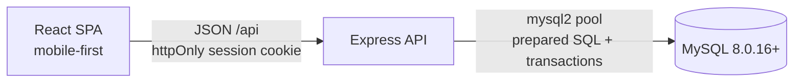

# Build Roadmap

**Current state:** design package only. No React or Express code exists yet.  
**Target stack:** React (Vite) + Node.js/Express + MySQL 8.0.16+.  
**First implementation phase:** Phase 1 — Foundation and stock.

## 1. Target architecture



- One repository, two apps: `client/` and `server/`.
- The React app is served by Vite in development and proxied to Express on
  `/api`, so cookies remain same-origin.
- Express owns authentication, authorization, validation, availability queries,
  and stock transactions.
- MySQL owns constraints, relationships, and atomic multi-row writes.
- No ORM; the course focus is SQL, so schema, queries, and transactions stay
  visible. Use parameterized SQL only.

## 2. Planned repository layout

```text
Final Project/
├── client/                     # Phase 1
│   └── src/
│       ├── pages/              # route-level screens
│       ├── components/         # shared UI
│       ├── lib/                # API client, formatting, unit helpers
│       └── App.jsx
├── server/                     # Phase 1
│   └── src/
│       ├── db.js               # mysql2 pool
│       ├── routes/             # auth, kitchen, inventory, recipes, sessions
│       ├── services/           # availability, stock, cooking transactions
│       ├── middleware/         # auth, validation, errors
│       └── app.js
├── db/
│   ├── schema.sql              # exists
│   ├── seed-reference.sql      # exists
│   ├── seed-content.sql        # Phase 2: ingredients + recipes
│   └── validate-seed.sql       # Phase 2: section 8 queries of 04
├── docs/                       # exists
└── README.md                   # exists
```

Keep the server simple: route → service → SQL. Do not add controllers,
repositories, and mappers unless a real duplication appears. Similar frontend
rule: pages, a few shared components, and one API helper.

## 3. Technical decisions for implementation

### Backend

| Concern | Decision |
|---|---|
| Runtime | Node.js 24 (installed), npm |
| HTTP | Express |
| Database access | `mysql2/promise` pool; parameterized SQL; services own transactions |
| Validation | `zod` at the API boundary |
| Passwords | `bcrypt` hashing (cost 12) |
| Auth | Signed JWT in an `httpOnly`, `SameSite=Lax` cookie; `Secure` in production; 8-hour expiry; no refresh token in MVP |
| Auth middleware | Resolve user from cookie; attach user ID; all kitchen/session queries scoped by owner |
| Config | `.env` loaded with `dotenv`; `.env.example` committed, `.env` ignored |
| Security basics | `helmet`; prepared statements; JSON body limit; no secrets or hashes in logs |
| Errors | Consistent `{ error: { code, message, details? } }`; 400 validation, 401 auth, 404 ownership/not found, 409 state/stock conflicts |
| Testing | Vitest + Supertest against a dedicated `kusina_test` database |

Auth limitations are explicit: no email verification, password reset, refresh
token rotation, or social login. CSRF protection relies on same-origin
deployment, `SameSite=Lax`, and a JSON-only API; stronger CSRF tokens can be
added later if deployment changes.

### Frontend

| Concern | Decision |
|---|---|
| Build | Vite + React |
| Routing | React Router |
| Data | Small `fetch` wrapper; page-level hooks; no global state library |
| Styling | Mobile-first CSS (plain CSS or CSS modules; pick one and stay consistent) |
| Forms | Native form state; server errors mapped to fields |
| Timer | Client-side `setInterval`; clearly advisory; stops when the page closes |
| Tests | Vitest for pure helpers; React Testing Library for critical screens (optional if schedule is tight) |

### Local development

- Express runs on `http://localhost:3000`.
- Vite runs on `http://localhost:5173` and proxies `/api` to Express.
- MySQL database `kusina`; tests use `kusina_test`.
- Database import and run commands are documented in the root
  [README.md](../README.md#database-quick-start).
- Never point tests at the demo database.

## 4. API contract (reference)

Names and shapes are the planned contract. Implement them in the phase shown;
small naming adjustments are fine as long as the frontend and tests agree.

### Phase 1 — auth, kitchen, inventory

| Method | Path | Purpose |
|---|---|---|
| POST | `/api/auth/register` | Create user + kitchen atomically |
| POST | `/api/auth/login` | Verify password; set session cookie |
| POST | `/api/auth/logout` | Clear session cookie |
| GET | `/api/auth/me` | Current user + kitchen summary |
| GET | `/api/kitchen` | Kitchen, equipment, and stock summary |
| PATCH | `/api/kitchen` | Rename kitchen |
| GET | `/api/equipment` | Fixed equipment catalog |
| PUT | `/api/kitchen/equipment` | Replace selected equipment IDs |
| GET | `/api/units` | Unit catalog (for display/input) |
| GET | `/api/ingredients?q=&category=` | Search fixed ingredient catalog |
| GET | `/api/inventory?q=` | Stock rows with canonical units |
| POST | `/api/inventory/entries` | Add/correct stock: `{ ingredientId, mode: "add" \| "set", quantity, unitId?, note? }` |
| POST | `/api/inventory/consumption` | Quick consume outside a session: `{ ingredientId, quantity, unitId?, note? }` |
| GET | `/api/inventory/transactions` | Ledger history, newest first |

### Phase 2 — recipes and availability

| Method | Path | Purpose |
|---|---|---|
| GET | `/api/recipes?available=true&servings=4&q=` | Recipe list with availability (and optional missing summary) |
| GET | `/api/recipes/:slug` | Full recipe detail, ingredients, equipment, steps |
| GET | `/api/recipes/:slug/availability?servings=4` | Availability plus missing equipment/ingredients for one recipe |

### Phase 3 — guided cooking

| Method | Path | Purpose |
|---|---|---|
| POST | `/api/cooking-sessions` | Start a session for an available recipe |
| GET | `/api/cooking-sessions/active` | Active session for resume, or empty |
| GET | `/api/cooking-sessions/:id` | Session, recipe, and current step |
| GET | `/api/cooking-sessions/:id/review` | Editable consumption preview with stock flags |
| POST | `/api/cooking-sessions/:id/advance` | Move to the next step |
| POST | `/api/cooking-sessions/:id/complete` | Confirm actual amounts and commit stock |
| POST | `/api/cooking-sessions/:id/abandon` | Abandon without stock changes |
| GET | `/api/cooking-sessions?status=completed` | History list |

All non-auth endpoints require a valid session cookie and operate only on the
current user’s kitchen. Cross-user IDs return 404, not 403, to avoid leaking
existence. Completion returns 409 with per-ingredient shortages when stock is
insufficient.

## 5. Phases

Each phase ends in something demoable. Do not start the next phase until the
previous phase’s tests and demo pass.

### Phase 0 — Design package (this deliverable)

**Deliverable:** this `docs/` set, `db/schema.sql`, `db/seed-reference.sql`.

**Done when:** the schema imports cleanly, the reference seed is idempotent,
the ERD/data dictionary match the DDL, the seed plan covers all 12 dishes, and
the roadmap is accepted.

### Phase 1 — Foundation and stock

**Goal:** a user can register, set up a kitchen, stock ingredients, see history,
and only see their own data.

**Build**
- Scaffold `client/` and `server/`; environment config; database pool; error
  middleware; health endpoint.
- Auth: register/login/logout/me; bcrypt; cookie JWT; ownership middleware.
- Kitchen creation in the registration transaction; kitchen name edit.
- Equipment catalog and selection.
- Ingredient catalog read endpoints.
- Inventory list, add, set/correct, quick consume, and ledger history.
- UI: sign in/register, kitchen setup, inventory, kitchen settings.
- Shared unit conversion helper used by API and UI formatting.

**Database work:** no schema changes expected; use the existing tables.

**Tests**
- Register creates exactly one kitchen; duplicate email is rejected; password
  is hashed; unauthenticated requests are rejected.
- Add uses `initial` for the first stock row and `restock` afterwards; set
  produces the correct signed adjustment; no-op and negative results are
  rejected.
- Quick consume cannot exceed the balance and writes a `consume` row.
- Each balance equals the sum of its ledger rows after every test.
- User A cannot read or mutate User B’s kitchen.
- Unit conversion: kg→g and L→ml work; mass↔volume and pc↔clove are rejected.

**Demo:** register, select stovetop + air fryer, add five ingredients, correct a
quantity, consume some, and show history.

### Phase 2 — Recipes and availability

**Goal:** the app shows only recipes the kitchen can cook and explains the rest.

**Build**
- Author the 45 ingredients and 12 recipes as `db/seed-content.sql`; add the
  demo kitchen fixture.
- Run all validation queries in
  [04-seed-data-plan.md](04-seed-data-plan.md#8-validation-queries) before UI work.
- Recipe list (Cook now and All recipes), detail page, serving selector,
  missing requirements, equipment badges.
- Availability service implementing the query in
  [03-database-design.md](03-database-design.md#71-availability-query), with
  exact decimal comparisons and scaling.
- UI: home/Cook now, recipe list, recipe detail.

**Tests**
- Missing oven hides Baked Macaroni; missing grill hides Chicken Inasal;
  missing pressure cooker hides Bulalo.
- A recipe needing stovetop + oven is unavailable when either is missing.
- Exact threshold is available; 0.001 below is not.
- Half servings halves every requirement; double servings doubles them.
- Optional ingredient missing does not hide a recipe.
- A missing required ingredient is returned in the missing list with the
  correct shortfall.
- kg↔g and L↔ml conversions work; count mismatches are rejected.
- The demo kitchen returns exactly the expected available set.

**Demo:** with the demo kitchen, show Adobo and Sinangag available, and show why
Baked Macaroni and Bulalo are not.

### Phase 3 — Guided cooking

**Goal:** a cook can follow a recipe with timers, resume after interruption, and
confirm consumption that atomically updates stock.

**Build**
- Session start with availability and one-active-session checks.
- Step viewer, progress, timer, resume, abandon.
- Consumption review with defaults, editable amounts, and stock flags.
- Completion transaction with row locks, validation, per-line consume
  transactions, and session completion.
- History: completed sessions, abandoned sessions, and linked consumption.
- UI: guided cook, review, history.

**Tests**
- Start rejects an unavailable recipe and a second active session.
- Advancing stops at the final step; completion is allowed only at the final
  step.
- Abandon changes no stock.
- Completion decreases each selected balance, writes ledger rows with the
  session ID, and marks the session completed.
- Insufficient actual stock returns 409 and rolls back every line; no partial
  deduction.
- Double completion returns 409 and deducts once.
- A user cannot view or complete another user’s session.
- Reload/resume returns the same current step.
- The final ledger still reconciles with balances.

**Demo:** cook Chicken Adobo end to end, refresh mid-cook, finish with edited
amounts, show updated stock and history; abandon a second session and show stock
unchanged.

### Phase 4 — Polish, hardening, and final demo

**Goal:** a reliable class demonstration and submission-ready project.

**Build**
- Loading, empty, and error states; form validation messages; mobile layout.
- History filtering and readable receipts.
- Security pass: cookie flags, 404 ownership behavior, prepared statements,
  password hashing, no secret leakage, input bounds.
- Seed demo reset script/workflow for repeatable demos.
- Documentation: setup, screenshots, final report material, known limitations.
- Optional, only if time allows: deploy to a school server, add automated
  end-to-end tests, or package for production build.

**Tests**
- Manual full demo twice from a clean database.
- Regression run of all previous tests.
- Accessibility basics: labels, keyboard navigation, contrast.
- No console errors; no unhandled promise rejections in the demo flow.

**Done when:** the demo scenario in
[01-product-scope.md](01-product-scope.md#8-demo-scenario) works from scratch and
all backlog items marked “MVP” pass.

## 6. Cross-phase test strategy

| Layer | What it proves | Tooling |
|---|---|---|
| Pure unit tests | Unit conversion, scaling, availability math, validation helpers | Vitest |
| API integration | Auth, ownership, SQL behavior, ledger/stock transactions | Vitest + Supertest + `kusina_test` |
| Database checks | Constraints, cascades, seed validation queries, reconciliation | SQL scripts run in test setup |
| UI tests | Critical form and guided-flow states | React Testing Library (optional) |
| Manual E2E | Full demo on mobile-sized viewport | Class demo script |

**Test database rules**

- Create `kusina_test` from `db/schema.sql`; never run destructive setup against
  `kusina`.
- Seed only the fixtures each suite needs; reset between suites in dependency
  order or recreate the test schema.
- Assert the ledger reconciliation invariant after every stock-mutating test.
- Do not mock the database for stock transactions; the point is to test SQL and
  atomicity.

**Minimum boundary cases to keep forever**

- Stock exactly equal to requirement.
- Stock short by 0.001.
- Optional item absent.
- Count unit mismatch.
- Completion with an insufficient line → full rollback.
- Double completion.
- Cross-user access.
- Abandon → no stock change.

## 7. Risks and mitigations

| Risk | Mitigation |
|---|---|
| Seed data takes longer than expected | Author two recipes at a time; validation queries gate the UI; do not expand the dish list |
| Availability bugs at serving boundaries | Keep the boundary tests; calculate in decimal, never rounded display values |
| Transaction bugs cause stock drift | Integration tests plus reconciliation after every stock test |
| Auth/security scope creep | Keep the documented cookie-JWT MVP; add refresh/reset/rate limits only when required |
| Timer/background behavior confuses testers | Label timers as advisory; test resume without a running timer |
| Equipment debate resurfaces | Use the recipe-driven allowlist rule; add equipment only with a recipe that needs it |
| MySQL version mismatch at school | Target 8.0.16+; document that older versions ignore CHECK constraints and require API-level checks |
| UI consumes too much time | Build the demo path first: inventory → Cook now → guided cook → completion; polish later |
| Sharing/multi-kitchen pressure | Keep the documented migration; do not add unused tables or permission UI before the MVP demo |

## 8. Immediate next steps after this package

1. Confirm the assumptions in this roadmap (Node/Express API, `Final Project/`
   location, returning backend).
2. Scaffold `client/` and `server/`; add `.env.example` and the database pool.
3. Implement Phase 1 auth and inventory, writing the integration tests alongside
   the services.
4. Only after Phase 1 is green, author the ingredient/recipe seed and run the
   Phase 2 validation gate.

The design is intentionally complete enough that the next engineering step is
scaffolding and Phase 1, not more schema debate.
