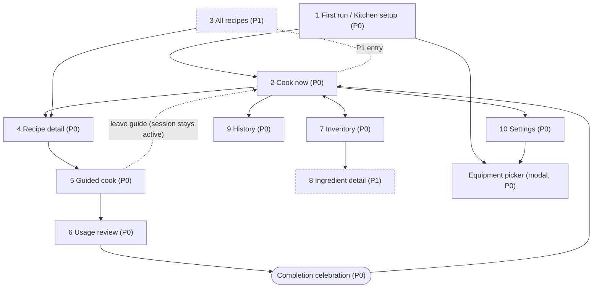

# Pixel-Art UI/UX Specification

**Status: draft for review - Owner: pixel-designer - Depends on: docs/01-05**

Reconciled against `docs/06-flutter-product-scope.md` §2-§5 (locked decisions L1-L6, label set, screen list) and `docs/09-guided-cooking-engine.md` §2/§6/§8/§9 (step model, timer, completion, UX contract). Where this document and `docs/06` disagree, `docs/06` wins; conflicts found while writing this are listed in §13.3 for T5.

Scope: the pixel-art visual language, the widget inventory, the ten screens, the tri-state interface, the guided-cook interaction and the asset budget. No Flutter code, no widget source, no copied artwork. Mockups in `design/mockups/` are generated by `design/mockups/generate.py` from `design/palette.json`.

Terminology used here (per `docs/06` §3.9): **stock status** (`unknown` / `have` / `low` / `out`), **stock event**, **usage review**, **availability** (`ready` / `needs_confirmation` / `blocked`), **base yield**. Banned in shipped copy and in this spec: *balance*, *quantity_delta*, *deduct*, *sign in*, *inventory transaction*, *stock level*.

---

## 0. The ten rules a developer must not break

1. Art is drawn on a **180 × 320 art-unit canvas** and shown at an **integer scale only**. No fractional bitmap scaling, ever.
2. **Instructions are never set in the bitmap font.** Body prose is real Flutter text, ≥ 18 sp, line height ≥ 1.35.
3. Stock is **four statuses, no numbers**: `unknown | have | low | out`. No keypad, no unit picker, no decimal field on any acceptance-path screen.
4. **`out` blocks, `unknown` asks, `have`/`low` are available.** A blocked recipe is still startable through **Guide me anyway** + confirm sheet.
5. The guide **never auto-advances**. Timers are advice; only a tap moves a step.
6. **One floor:** every interactive target has a hit rect of at least **48 dp (24 au) in both dimensions**; the single primary action on a screen is **56 dp (28 au)** tall. Chips, buttons and review choices draw at their hit size (24 au); only a glyph-only icon button may draw a smaller glyph inside a padded 24 au target.
7. Scene = **one background + at most three sprites + one text panel**. No bespoke per-step or per-dish art.
8. Status is **colour + icon shape + label**, never colour alone.
9. The **button label follows the availability state**: Start cooking / Start and confirm items / Guide me anyway.
10. Celebration happens **once**, after the usage review is confirmed — never before, never on resume.

---

## 1. Visual language

### 1.1 The canvas

| Property | Value |
|---|---|
| Logical canvas | 180 × 320 art units (au), portrait 9:16 |
| Reference render | 540 × 960 px = 3 × 180 × 320, nearest-neighbour (`design/mockups/*.png`) |
| Allowed integer scales | 2×, 3×, 4× (360×640, 540×960, 720×1280) |
| Palette | 16 colours, `design/palette.json` |
| Pixel grid | every art rectangle is axis-aligned and an integer number of au; no rotation, no skew, no anti-aliased vector shapes in the art layer |
| Sprite sizes | 16×16 (icons, mascot), 32×32 (step scenes, dish stamps), 9-slice frames |
| Text | a separate layer above the art, laid out in dp (see §3) |

The canvas is a **scene canvas, not the app viewport**. Flutter lays the app out in dp; the art layer is a bitmap canvas that occupies the width and is centred vertically. Text, hit targets and scrolling live in dp, so a taller phone does not stretch the art — it gets palette-coloured bars.

### 1.2 Scaling rules

Two layers, two rules:

| Layer | Rule |
|---|---|
| **Art layer** (backgrounds, sprites, frames, rings) | one art pixel = `k` **device pixels**, `k` an integer. `k = max(1, floor(screenWidthPx / 180))` where `screenWidthPx = MediaQuery.size.width * devicePixelRatio`. |
| **Text layer** (all prose, labels, numbers as text) | normal Flutter text in dp/sp; never scaled with the bitmap. It does not snap to the art grid. |

Reference device: 360 × 640 dp at DPR 3 (1080 × 1920 device px). `k = floor(1080 / 180) = 6` device px per art unit → 1 au = 2 dp. Every au size in this document therefore converts at **1 au = 2 dp** on the reference device.

| Device | Device px wide | DPR | `k` | Art width | Side bars |
|---|---:|---:|---:|---:|---:|
| 360 × 640 dp | 1080 | 3 | 6 | 360 dp | 0 |
| 393 × 852 dp | 1179 | 3 | 6 | 360 dp | 16.5 dp each |
| 412 × 915 dp | 1236 | 3 | 6 | 360 dp | 26 dp each |
| 320 × 568 dp (SE) | 640 | 2 | 3 | 270 dp | 25 dp each |
| 800 × 1280 dp tablet | 1600 | 2 | 8 | 720 dp | 40 dp each |

Never: `FittedBox`, fractional `Transform.scale`, `BoxFit.contain` on a sprite sheet, a 1.5× "retina" asset, or a resized PNG. Re-export at the integer size instead.

### 1.3 Flutter implementation notes

| Concern | What to build |
|---|---|
| Bitmap sampling | `Image(filterQuality: FilterQuality.none)` and `Paint()..filterQuality = FilterQuality.none` for every art image. No `FilterQuality.medium` anywhere. |
| Pixel snap | position art at `Offset((au * k) / dpr, ...)` so art edges land on device-pixel boundaries; do not use centred fractional offsets. |
| Canvas widget | one `PixelCanvas` widget: `LayoutBuilder` → compute `k` → `Stack` of `Positioned` art and a dp-positioned content column. `RepaintBoundary` around the art layer. |
| Device pixel ratio | read `MediaQuery.devicePixelRatio` once per layout; never assume 3.0; recompute `k` on rotation/size change (portrait only for P0). |
| Safe areas | wrap the canvas in `SafeArea`; art never draws under the notch or gesture bar. The mockup status strip (0-12 au) is a placeholder for the system status bar, not app content. |
| Text scaling | respect `MediaQuery.textScaler` up to 1.3×, then clamp; the art frame grows with the text block, never shrinks the font. |
| Scrolling | dp scrolling inside an art frame; the 9-slice frame does not scroll. |
| Animations | `AnimatedBuilder` + `CustomPainter` for progress/ring; step-card slide with `AnimationController`; no implicit animation on resume (instant paint). |
| Fonts | system sans (Roboto / SF); bitmap font shipped as one PNG atlas + glyph metrics. No web fonts, no network. |
| Assets | one `assets/pixel/` directory, flat PNG, no @2x/@3x variants; the manifest in §11.3 is the source of truth. |
| Colour | palette hex only; disabled states use palette colours, not opacity; text contrast is checked in §2. |

### 1.4 Layout grid

| Region | Height (au) | Notes |
|---|---:|---|
| System status (placeholder) | 12 | system draws it; mockups only |
| App bar | 26 | title (bitmap 1×) + back/close + one optional glyph |
| Progress bar (guide only) | 5 + 3 gap | under the app bar |
| Content | 180-280 | panels, cards, lists |
| Primary action | 28 (56 dp) | full content width, fixed above the bottom edge; the only 28 au control |
| Bottom tab bar | 24 | Cook / Recipes / Stock / History |
| Content margin | 6 au left/right (12 dp) | panels span 168 au |

---

## 2. Palette

16 colours. Source of truth: `design/palette.json`. Reference material: clay cooking pots, adobe walls, banig weave, calamansi, coconut cream, annatto — a warm Filipino kitchen, **not** the national flag.

| # | Token | Hex | Role |
|---:|---|---|---|
| 1 | `ink` | `#1B1410` | primary text, icon strokes |
| 2 | `ink_soft` | `#4A3A2C` | secondary text, inactive tabs, unknown text |
| 3 | `adobo` | `#2A1E18` | 9-slice border, shadow, dark toast/dialog base |
| 4 | `cream` | `#F6EAD3` | app background (coconut cream wall) |
| 5 | `cream_dark` | `#E4D1B2` | panel fill, disabled fill, unknown chip fill |
| 6 | `clay` | `#A8432B` | primary button, selected control (adobe clay) |
| 7 | `clay_dark` | `#7C2E1C` | pressed primary, accent text, active tab |
| 8 | `banig` | `#D9A23F` | banig-weave bands, progress fill, dark-panel highlight (decoration only) |
| 9 | `calamansi` | `#7E9C33` | `Have` fill, `Ready` badge fill |
| 10 | `calamansi_dark` | `#4A6416` | `Have` dot/icon, success text |
| 11 | `amber` | `#E0A32B` | `Low` fill, `Probably have` badge fill |
| 12 | `amber_dark` | `#7A4E08` | `Low` dot/icon, caution text |
| 13 | `rust` | `#B23A2F` | `Out` / `Missing` fill, destructive |
| 14 | `rust_dark` | `#7A2119` | `Out` dot/icon, missing text |
| 15 | `slate` | `#8A9299` | neutral dot, disabled icon, unknown border (never text) |
| 16 | `white` | `#FFF8EA` | text on dark/saturated fills, raised panel, highlight |

### 2.1 WCAG contrast checks (all AA or better)

| Text on fill | Ratio | Grade | Use |
|---|---:|---|---|
| `ink` on `cream` | 15.27 | AAA | body prose |
| `ink` on `white` | 17.21 | AAA | body prose on raised panels |
| `ink_soft` on `cream` | 9.12 | AAA | secondary prose |
| `ink_soft` on `cream_dark` | 7.28 | AAA | unknown chip text |
| `white` on `clay` | 5.67 | AA | primary button label |
| `white` on `clay_dark` | 8.77 | AAA | pressed primary |
| `clay_dark` on `cream` | 7.78 | AAA | accent text, active tab |
| `clay` on `cream` | 5.03 | AA | large accent text only |
| `cream` on `adobo` | 13.59 | AAA | toast text |
| `white` on `adobo` | 15.31 | AAA | dialog title |
| `ink` on `calamansi` | 5.80 | AA | `Have` chip text |
| `ink` on `amber` | 8.18 | AAA | `Low` chip text |
| `white` on `rust` | 5.61 | AA | `Out` / `Missing` chip text |
| `calamansi_dark` on `cream` | 5.64 | AA | success line |
| `amber_dark` on `cream` | 6.04 | AA | caution line |
| `rust_dark` on `cream` | 8.56 | AAA | missing line |
| `ink` on `banig` | 7.96 | AAA | label on banig strip |
| `banig` on `adobo` | 7.08 | AAA | weave highlight on dark toast |

**Forbidden pairs** (fail AA): `white` on `calamansi` (2.97), `white` on `banig` (2.16), `white` on `slate` (2.99), `clay` on `cream_dark` (4.01). A new colour requires a new contrast row in `palette.json` and an amendment here.

### 2.2 Status colour language

| Status | Fill | Text | Icon shape | Dot |
|---|---|---|---|---|
| `have` | `calamansi` | `ink` | ✓ check | `calamansi_dark` |
| `low` | `amber` | `ink` | ◐ half-filled circle | `amber_dark` |
| `out` | `rust` | `white` | ✕ cross | `rust_dark` |
| `unknown` (label "Probably have") | `cream_dark` | `ink_soft` | ? question mark | `slate` |

Colour is never the only signal: shape + label always ship together. This is also the colour-blind-safe path.

---

## 3. Typography

### 3.1 The hard rule

> **Never set instructions, steps, ingredient prose or review copy in the 5×7 bitmap font.**

Bitmap font (a hand-built 5×7 glyph table, uppercase A-Z, 0-9, `.:!?/-%+()'`) is for **screen headings, section labels, tab labels, action-button labels and numerals (step counters, timer digits, counts) only**. It has no lowercase, so it never renders a locked label. The four stock statuses (**Have / Low / Out / Probably have**), the three availability badges (**Ready / Probably have / Missing**) and the three review choices (**Didn't use / Used it / Used it up**) are copy-critical: they are always real anti-aliased system sans in the locked title case, so the strings appear verbatim (`docs/06` §3.4). Anything a cook must *read as a sentence* is real Flutter text too.

Why: the phone is read at arm's length (50-80 cm) on a counter, often with wet or busy hands, in a dim kitchen with glare. A 5×7 pixel font has no lowercase, no descenders and no word shapes; at 14-18 dp it becomes texture, not text. Pixel body copy also argues against the accessibility claim the project is making.

### 3.2 Type scale (normative)

| Role | Font | Size | Line height | Colour | Used by |
|---|---|---:|---:|---|---|
| Screen heading | bitmap 2× (14 au) | 28 dp cap | — | `ink` | "COOK NOW" |
| Section label | bitmap 1× | 14 dp cap | — | `ink_soft` | "INGREDIENTS", "COOKING METHOD" |
| Action-button label | bitmap 1×-2× | 14-28 dp cap | — | per component | "CONTINUE", "CONFIRM", "GUIDE ME ANYWAY" |
| Status chip / availability badge / review choice / status tag | system sans bold | 14-16 sp | 1.2 | state colour pair | locked title-case strings, verbatim |
| Step title | system sans bold | 20 sp | 1.3 | `ink` | step card title |
| Instruction / body prose | system sans | **18 sp minimum, 20 sp default** | **≥ 1.35 (25-28 dp)** | `ink` | steps, dialogs, detail |
| Row / ingredient label | system sans | 16 sp | 1.3 | `ink` | lists, review lines |
| Secondary / meta | system sans | 14 sp | 1.3 | `ink_soft` | durations, counts, "tap to confirm" |
| Timer digits | bitmap 2× | 28 dp cap | — | `ink` on light, `cream` on the dark timer panel | ring centre |

Rules:

- Line length ≤ 40 characters at 180 au width; recipe copy is authored to that (`docs/09` L2: instruction ≤ 180 chars).
- Letter spacing 0; no all-caps body prose; no justified text; no italics for instructions.
- Reserve the pixel font for short strings: ≤ 16 characters per section label, ≤ 13 per action button (bitmap 2×), ≤ 20 at bitmap 1×.
- Never set a locked label in the bitmap face: Have / Low / Out / Probably have, Ready / Probably have / Missing and Didn't use / Used it / Used it up stay in title-case system sans (F-18).
- Text may reflow when `textScaler` grows; the art frame grows, never the font shrinks.
- Never render body text at 1× on the 540-wide artboard: if the font size in image px is under 24 px, it is chrome, not prose.

### 3.3 The mockups demonstrate it

`design/mockups/*.png` deliberately render headings, section labels, tab labels, action buttons and numerals in the 5×7 bitmap font, while status chips, availability badges, review choices and all prose are Arial at 21-27 px (≈ 14-18 dp at the reference viewport) so every locked label reads verbatim in title case. The README states this is the intended reading of "readable body text, pixel chrome".

---

## 4. Component inventory

All sizes in art units; `dp` assumes the reference device (1 au = 2 dp). **One floor:** every interactive control is at least **24 au (48 dp) in both dimensions** and draws at its hit size; the single primary action is **28 au (56 dp)**. This is the C6 resolution (F-05): 48 dp hit minimum, 56 dp for the one primary action; no other control grows.

| Component | Size (au) | Visual / hit | States | Build notes |
|---|---|---|---|---|
| **9-slice panel** | any | — | raised, inset, dark | 2 au `adobo` border, 2 au offset shadow, 1 au `white` inner highlight top/left, `cream_dark` shade bottom/right; corners are square (cut the 1 au corner pixel for a pixel-notched look). No radius. |
| **Primary button** | 168 × 28 (336 × 56 dp) | hit 28 au | idle / pressed / disabled / loading | `clay` fill, `clay_dark` border, `white` bitmap label 1×-2× (auto-fallback to 1× when the label exceeds the width). Pressed = 1 au down, fill `clay_dark`. Disabled = `cream_dark` fill, `ink_soft` text, `slate` border. Loading = label replaced by three 4 au blocks stepping (no spinner). The only 28 au control; every other target is 24 au or taller. |
| **Secondary button** | 168 × 24 (336 × 48 dp) | hit 24 au | idle / pressed / disabled | `cream` fill, `clay` border, `clay_dark` text. Used for the restock confirm ("I have it", §8.1) and other secondary paths. |
| **Progress bar** | 168 × 5 | — | 0-100% | `cream_dark` track, `clay` fill with 1 au `banig` top highlight; integer percent in the a11y label only; no percentage text on screen. |
| **Timer ring** | 56 au diameter, 3 au thick | full-ring hit (56 au); tap = start/pause | idle / running / done / overrun | idle: `cream_dark` track only + "Start timer"; running: `clay` arc clockwise from 12 o'clock + bitmap countdown; done: `calamansi_dark` full ring + ✓; overrun: `rust` full ring + clock glyph + "finished N ago". One ring per step. |
| **Step card** | 168 × 115 | — | prep / heat / cook / wait / finish | panel + order badge (16 au square, `clay`) + title + instruction + optional detail + divider + timer row + caution row. Anatomy in §9.1. |
| **Inventory status chip** | 76 × 24 (152 × 48 dp) | hit 24 au | `have` / `low` / `out` / `unknown`; selected / unselected | One chip per status, four per ingredient in a **2 × 2 grid**: 76 + 4 + 76 = 156 au wide, 24 + 2 + 24 = 50 au tall. Selected = state fill + icon + title-case label; unselected = `cream` fill + `ink_soft` label. Four chips cannot share one 168 au row at the floor, so the grid is normative (F-05). One tap writes one stock event. |
| **Recipe-detail status chip** | 68 × 24 (136 × 48 dp) | hit 24 au | same four states | Right-aligned in a required-ingredient row; colour + icon + title-case label. A read-only status display — stock is written only from Inventory or the usage review. |
| **Review choice** | 48 × 24 (96 × 48 dp) | hit 24 au | unselected / selected / disabled | Three per line: 3 × 48 + 2 × 4 = 152 au. Selected = `clay` fill + `white` text; unselected = `cream` fill + `ink` text; disabled = `cream_dark` fill + `slate` text ("Used it" on an `out` line). |
| **Review status tag** | 72 × 24 (144 × 48 dp) | hit 24 au | `have` / `low` / `out` / `unknown` | Read-only always; the restock control is the separate **I have it** chip (§8.1), never the tag. |
| **Method button** | 78 × 36 (156 × 72 dp) | hit 36 au | unselected / selected / disabled | Method sprite 16 × 16 au + title-case method label (Pan-fry / Air-fry, 14 sp bold) + that method's availability badge 12 au tall along the bottom. Two per row: 78 + 4 + 78 = 160 au. Selected = `clay` fill + `white` text + ✓; unselected = `cream` fill + `ink` text + `slate` border; disabled only while an `in_progress` session pins the method. §7.1. |
| **Equipment badge** | 14 tall | — | owned / missing | 16×16 equipment icon + bitmap label; missing = `rust` text + cross. |
| **Availability badge** | label width + 14 au, 15 tall (12 inside a method button) | — | Ready / Probably have / Missing | Title-case system sans bold on the state fill; the only recipe-level status. |
| **Toast** | 160 × 24 | — | info / success | `adobo` panel, 1 au `banig` top line, ✓ icon + 14-16 sp text; 2.5 s, swipe to dismiss, never the only carrier of a required action. |
| **Dialog** | 150 wide | two buttons ≥ 24 au tall | confirm / destructive | `adobo` panel, title bitmap 1×, body 16 sp `cream`, two buttons stacked (destructive last, default Cancel). Used for abandon and Reset demo data only. |
| **Mascot bubble** | ≤ 100 wide, 2 lines | — | idle / caution / celebrate | `white` 9-slice + 2 au tail; text 14-16 sp `ink`; points at the mascot sprite. |
| **Dish stamp** | 48 on cards/detail, 16 in list rows | — | static | One 32×32 sprite per dish; never animated outside the completion celebration. |
| **Tab bar** | 180 × 24 | 4 × 45 × 24 au targets (90 × 48 dp) | active / inactive | icon 12 au + bitmap label 1×; active `clay_dark` + 2 au `clay` underline. |

Interaction rules for every component: no hover state (touch only), no long-press-only action, no double-tap, no gesture required to complete a cook, **no control whose hit rect is under 24 au in either dimension** (a glyph-only icon button pads its 16 au glyph to a 24 au target), motion only as specified in §10.

---

## 5. Tri-state UI (critical)

### 5.1 Four statuses, one chip set

Stock is stored as one of `unknown | have | low | out` (`docs/06` L3). The user-facing chip labels are locked by `docs/06` §3.4: **Have / Low / Out / Probably have**. `unknown` and "Probably have" are the same status; the brief's phrase "Not tracked" describes exactly that state and is **not** a fifth concept. Never display both "Probably have" and "Not tracked" for the same row.

| Stored | Chip label | Icon | Meaning | Availability effect |
|---|---|---|---|---|
| `have` | **Have** | ✓ | "I have enough for this dish" | available |
| `low` | **Low** | ◐ | "a little left, may run short" | available + warning "you may run short" |
| `out` | **Out** | ✕ | "none" | **missing** (blocks, Guide anyway available) |
| `unknown` | **Probably have** | ? | "never set, or I don't know" | **asks** — `needs_confirmation`, never blocks |

### 5.2 The four states in each surface

| Surface | How the four states appear |
|---|---|
| **Inventory** | One row per ingredient: name (English + Filipino gloss) above a **2 × 2 grid of four 76 × 24 au chips**, the current one filled. One tap writes one stock event. The `unknown` row adds the inline hint "tap to confirm". No numeric field, no unit picker, no search-by-amount. |
| **Ingredient detail (P1)** | Current status as the same four chips + append-only event history (`from → to`, reason, time, session link). No edit/delete. |
| **Recipe detail** | Required ingredients are rows with a status chip; only `out` rows feed the Missing panel; `unknown` rows add a "confirm" prompt; `low` rows add the "may run short" warning. Optional ingredients are listed once, collapsed, and never appear as missing. |
| **Cook now / All recipes** | The recipe-level badge (Ready / Probably have / Missing) only; individual chips never appear on a card. |
| **Usage review** | Each line shows its current status as a 72 × 24 au tag (`Have`/`Low`/`Out`/`Probably have`) above three 48 × 24 au choices; tapping a non-`have` tag offers **I have it** (the restock correction, §8.1). `unknown` lines keep the three choices; choosing one writes `unknown → low` / `unknown → out` per `docs/06` §3.4. |
| **History** | Event rows read `Have → Low`, `Low → Out`, `Out → Have` (restock) with the reason chip; no amounts. |

### 5.3 No numbers, anywhere on the acceptance path

Banned from Inventory, Recipe detail and Usage review: numeric keypad, decimal field, unit dropdown, serving selector, "quantity" label, "g" / "ml" / "pc" text input, any comparison of an amount to a requirement. Recipe lines keep quantities as **display-only prose inside step copy** ("6 cloves garlic") exactly as seeded; the same is true of the base-yield line ("Base yield: 4 servings"). The only numbers a cook can edit are none. The only numbers shown as UI are timers, step counters, counts of items, and read-only instruction text.

Acceptance test (`docs/06` §8 #5): zero numeric input fields exist on those three screens; a screenshot audit must show only read-only numerals.

### 5.4 Copy

| Situation | Copy |
|---|---|
| Unknown row hint | "tap to confirm" |
| Low recipe warning | "you may run short" |
| Unknown recipe badge | "Probably have" + "confirm items" |
| Blocked recipe badge | "Missing" + the missing list |
| Review decay note | "Used it: Have → Low. Used it up: → Out." |
| Persistence note | "This stays on this phone." |

Never: "how much?", "quantity", "amount left", "balance", "deduct", "per serving".

---

## 6. Navigation map

Ten screens (`docs/06` §5). The equipment picker is a **modal** reached from First run and Settings, not an eleventh screen. P0 = demo path, P1 = built after the demo core.



| # | Screen | Priority | Reached from | Back behaviour |
|---|---|---|---|---|
| 1 | First run / Kitchen setup | P0 | cold start (once) | no back; "Skip" keeps defaults |
| 2 | Cook now | P0 | app open | exit app |
| 3 | All recipes | P1 | tab bar | tab bar |
| 4 | Recipe detail | P0 | Cook now, All recipes | back = list |
| 5 | Guided cook | P0 | Recipe detail, resume card | close = leave (session stays active) |
| 6 | Usage review | P0 | advance on final step | back = re-open review (no partial credit) |
| 7 | Inventory | P0 | tab bar, Cook now link | tab bar |
| 8 | Ingredient detail | P1 | Inventory row | back = Inventory |
| 9 | History | P0 | tab bar | tab bar |
| 10 | Settings | P0 | gear in app bar | back = previous |
| — | Equipment picker (modal) | P0 | First run, Settings | dismiss = keep previous selection |

Mapping to the T2 brief's ten screens: *onboarding/profile setup* = 1; *Cook Now* = 2; *All recipes* = 3; *Recipe detail* = 4; *Guided cook* = 5; *Completion review* = 6 (locked name: Usage review); *Inventory/stock* = 7; *History* = 9; *Settings* = 10; *equipment selection* = M1 (modal inside 1 and 10). `docs/06` §5 lists Ingredient detail as screen 8 instead of a standalone equipment screen; this spec keeps both by making the picker a modal.

---

## 7. Per-screen specification

Regions are top to bottom. "Never wrong" is the single behaviour a developer must not get wrong on that screen.

| # | Screen | Purpose | Layout regions (top → bottom) | Components | Primary action | Empty / loading / error | Never get this wrong |
|---|---|---|---|---|---|---|---|
| 1 | **First run / Kitchen setup** | Create the one profile: name + equipment + privacy note | app bar (no back) → heading + mascot → kitchen name field (pre-filled "My Kitchen") → equipment grid (5 toggles, 2 columns) → "This stays on this phone." → primary "Start cooking" → "Skip" | 9-slice field, toggle rows, equipment badges, note, primary button | Save profile → Cook now (one local transaction) | Empty name → inline error, save disabled; no equipment is **valid** and must still save; no network/loading state | An empty equipment selection must not block first run; it just makes equipment-dependent recipes `blocked` |
| 2 | **Cook now** | What can I cook, and resume if mid-cook | app bar (KUSINA, gear) → greeting + kitchen name + equipment chip → active-session resume card (only when one exists) → 3 recipe cards (stamp, name, base yield + time, availability badge) → tab bar | dish stamp, card panel, availability badge, resume card (`clay_dark`, recipe + step) | Open a recipe card (or Resume) | No active session → resume card absent; no recipes → "No dishes seeded" (seed error); badges recomputed per read | The resume card sits above the recipe list, shows the step, and never auto-opens the guide |
| 3 | **All recipes** (P1) | Browse all dishes with the same three states plus a filter | app bar → filter chips (All / Ready / Probably have / Missing) → list rows (stamp 16, name, badge, equipment) → tab bar | filter chips, list rows, badges | Open recipe | Filter with no match → "Nothing matches. Clear filter."; no loading state (local) | Availability is computed live; never a stored `cookable` flag |
| 4 | **Recipe detail** | Decide to cook: method, requirements, missing list, start | app bar (back) → hero (stamp 48, name, base yield, difficulty, equipment) → method control (only if the recipe has more than one method) with **per-method availability badges** → availability panel (badge + missing list + `low` warning), re-evaluated when the method changes → required ingredient rows with status chips → optional line (collapsed) → primary action | method control with per-method badges, availability badge, status chips, primary button | Start cooking / Start and confirm items / Guide me anyway (label follows the selected method's state) | Blocked → primary is Guide me anyway, never a silent start; no method is pre-selected and Start is disabled (copy "Choose Pan-fry or Air-fry") until the cook taps one; methods → control hidden; base yield is static text, **no serving selector** | The **method control is P0**, never auto-selected, and never swapped: the panel, the missing list, and the start label always follow the method the cook tapped. Blocked starts must pass through the confirm sheet that names every missing requirement and must record `started_without_availability = true` |
| 5 | **Guided cook** | Follow one step at a time, timer optional | app bar (step counter, close) → progress bar → scene (background + ≤ 3 sprites) → step card (order, title, instruction, detail, timer row, caution) → primary "Continue" → hint lines | progress bar, ring, step card, mascot bubble, caution row | Continue (advance exactly one step) | No timer → timer row reads "No timer on this step"; resume banner when returning; stale timer → `overrun` copy | Never auto-advance on timer end, notification tap, resume or clock jump |
| 6 | **Usage review** | Report what the dish used, in statuses | app bar (back) → heading + tap-cost line → ingredient rows (name + 72 × 24 read-only status tag; three 48 × 24 choices below; separate **I have it** chip under the tag) → primary "Confirm" → decay note and restock hint | review rows, choices, status tags, primary | Confirm (one atomic write) | Out-of-stock line → "Used it" disabled; unknown line → 3 choices + "Probably have" tag; confirm failure → nothing changes + toast | At most one **usage** event per ingredient (a restock correction may add one more), no numbers, and `low` + "Used it" writes nothing (see §8). At the 48 dp floor four lines fit, so the list scrolls inside the pinned panel (count + clipped row + scrollbar) |
| 7 | **Inventory** | Set or correct stock status in one tap | app bar (count) → search → category chips → rows (name + **2 × 2 grid** of four 76 × 24 au chips; the list scrolls) → toast | search field, filter chips, stock rows, toast | Tap a chip = write the status | No match → "No ingredient matches."; no stock events yet → every row `unknown`; write failure → row reverts + toast | No numeric input; every change is a legal stock-event transition with a reason; no silent inference from an absent row. The row is a 2 × 2 grid, **never four chips in one line** — four 24 au chips cannot share the 168 au content width (F-05) |
| 8 | **Ingredient detail** (P1) | Explain one ingredient's status and history | app bar (back) → name + category + display unit (prose) → current status chips → event list (from → to, reason, when, session link) | chips, event rows, reason badges | Change status (same chips) | No events → "No changes yet."; seed missing → error row | History is append-only; corrections add an event, never edit one |
| 9 | **History** | Show completed and abandoned cooks and the events they wrote | app bar → segmented (Sessions / Stock events) → session rows (dish, result, step reached, when) → event rows (ingredient, from → to, reason) → tab bar | segmented control, list rows, reason chips | Open a session (read-only) | No cooks → "No cooks yet. Start with Cook now." | Abandoned sessions appear but wrote zero events; completed sessions link to their events |
| 10 | **Settings** | Kitchen name, equipment, reset, safety note | app bar (back) → name field → equipment list (5 toggles, "no dishes yet" on the 3 unused) → safety note ("This stays on this phone.") → destructive "Reset demo data" (disabled while a session is `in_progress`) → version | field, toggles, destructive row, dialog | Save (auto on change) | Reset → confirm dialog naming what is lost; cancel is default; active session → row disabled with "Finish or abandon the Adobo cook first" | Reset is the only destructive action, must confirm, and is **blocked while a session is `in_progress`** (Resume/Abandon first); equipment edits never change an active session's pinned path |
| M1 | **Equipment picker** (modal) | Choose the 5 appliances once, edit later | sheet: title → 5 toggles with icons → "Unused appliances still appear here" note → "Done" | toggle rows, equipment icons, sheet button | Done (saves on close) | Unused three show "no dishes yet"; deselected required appliance makes recipes `blocked`, never hidden | Equipment is a **hard** requirement inside advisory availability: unowned appliance on the cook's chosen method = `blocked` with `equipment:<id>` in the missing list |


**On "secondary" Guide me anyway.** The brief calls Guide me anyway a secondary action; in this
spec it means *the alternative start path*, not a low-emphasis link. Its visual weight follows the
availability state: on a `blocked` recipe it is the only enabled primary (mockup 02 shows the Air-fry
method selected as `Missing`, so the panel reads Missing and the primary is Guide me anyway; matching
`docs/06` §7 step 4); on a `needs_confirmation` recipe the primary is **Start and confirm items** and
Guide me anyway is not shown at all, because there is nothing to override yet.

### 7.1 Method control (P0)

Recipe detail only, and only when the recipe has more than one method (today: Crispy Pork Belly).

- **Two buttons in one row — Pan-fry and Air-fry.** Each is 78 × 36 au (156 × 72 dp; 36 au hit, well over the 24 au floor) and carries that method's 16 × 16 sprite (`variant_panfry` / `variant_airfry`), its title-case label (14 sp bold), and **its own availability badge** (12 au tall, title-case system sans) computed for that method's path. Two buttons + a 4 au gap = 160 au of the 168 au content width.
- **No preselection.** Both start unselected (`cream` fill, `ink` text, `slate` border). The primary action is disabled (28 au disabled primary) with the copy **Choose Pan-fry or Air-fry** until the cook taps one. A method is required to start, and tapping the selected button does not clear it.
- **Selected state.** Picked button = `clay` fill + `white` text + ✓ (2 au `clay_dark` border); picking the other swaps it. On every change the availability panel, the missing list, the `low` warning and the primary label re-render for the picked method: `Ready` → **Start cooking**, `Probably have` → **Start and confirm items**, `Missing` → **Guide me anyway** (blocked path, confirm sheet).
- **Disabled state.** A method button is disabled (`cream_dark` fill, `ink_soft` text, `slate` border) only when that recipe's method is already pinned by an `in_progress` session: the picked button stays selected and disabled, and the primary action is **Resume** (the path is pinned, `docs/09` §4.6). Disabled is never used to hide a method — a `Missing` method is still selectable so **Guide me anyway** stays reachable (L5).
- **Never:** auto-select a method, default to the canonical one, or fall back to the other method when the picked one is `blocked`. A blocked pick shows **Guide me anyway**, starts the picked path and records `started_without_availability = true`; the missing list names the picked method's appliance with its code — `equipment:stovetop` for Pan-fry, `equipment:air_fryer` for Air-fry.
- **Pin.** The pick is the cook's explicit choice and is written at start to `session_step_choices` (one row per step: the variant / equipment for the picked method). The unpicked method's copy never appears on this screen or in the guide.
- **Priority: P0.** The control ships with the demo (`docs/10` D9, condition C3). Its illustrative mockup state selects Air-fry as `Missing` to prove the gating, with Pan-fry showing `Probably have` because a required ingredient is unconfirmed.

---

## 8. Usage review UI

### 8.1 Layout

```
app bar: back · USAGE REVIEW · recipe name
heading  "What did you use?"             (20 sp bold)
sub      "One tap per ingredient, then confirm once."   (14 sp)
panel (the list scrolls; the primary stays pinned below)
  INGREDIENTS · 8 LINES                   (bitmap label + count)
  row × N:  ● name .............. [status tag]      (68 × 24 au; read-only)
            [ I have it ]                            (48 dp chip; only when not `have`)
            [ Didn't use ] [ Used it ] [ Used it up ]   (48 × 24 au each)
primary  [ CONFIRM ]                     (168 × 28 au = 56 dp)
note     "Tap a status tag: I have it. Used it: Have → Low. Used it up: → Out."   (14 sp, two lines)
```

- Status tag = the same chip language as §5 (`Have` / `Low` / `Out` / `Probably have`), **68 × 24 au (136 × 48 dp)**. It is a **read-only** status display; the restock control is the separate **I have it** chip below it (see the restock bullet). Mockup 05 predates this split and still draws the tag as the control.
- Three choices, mutually exclusive, one per line, each **48 × 24 au (96 × 48 dp)**: 3 × 48 + 2 × 4 au gap = 152 au. Selected choice = `clay` fill + `white` text; unselected = `cream` fill + `ink`. No numbers, no steppers, no slider.
- **Scrolling.** At the 48 dp floor four rows fit above the pinned primary (Chicken Adobo has 8), so the list scrolls inside the panel; the count in the panel header, a clipped last row and a 2 au scrollbar are the cue. The primary and the decay note never scroll.
- `out` + **Used it** is disabled (`cream_dark` fill, `slate` text) with the copy "already out" in the accessibility label.
- `unknown` lines show the tag "Probably have" and keep all three choices; choosing writes `unknown → low` / `unknown → out` (`docs/06` §3.4).
- **Restock correction — "I have it".** A separate **I have it** chip sits under the status tag on every line that is not `have` (`cream` fill, `clay` outline, 48 dp hit target, no modal). Tapping it flips the chip to **I have it ✓** and marks the line for a restock; tapping again cancels. The line's three-way choice is untouched; confirming the review applies the restock **before** that line's usage transition, inside one completion transaction (`docs/09` §8.4). This is a fourth, secondary affordance, not a fourth main choice, and it is the only way to move a line to `have` from this screen. Status stays readable while the correction is pending.

### 8.2 Tap cost

One tap per ingredient + one confirm = **N + 1 taps** (Chicken Adobo, 8 lines → 9 taps), plus **one optional tap per restock correction** (the **I have it** chip), so a normal cook costs N + 1 and a correction costs N + 2. No modal per line, no keyboard. Four lines fit above the pinned confirm at the 48 dp floor, so longer recipes (Adobo: 8 lines) scroll inside the panel with the confirm button pinned. Defaults are pre-selected — required `have`/`low` lines at **Used it**, optional lines and `unknown`/`out` lines at **Didn't use** (§8.4) — so a cook who agrees can confirm without touching a row.

### 8.3 Transitions (normative for the UI)

Following `docs/06` §3.4 (product owner's locked semantics):

| Current status | Didn't use | Used it | Used it up |
|---|---|---|---|
| `have` | no event | `have → low` | `have → out` |
| `low` | no event | **no event, stays `low`** | `low → out` |
| `unknown` | no event | `unknown → low` | `unknown → out` |
| `out` | no event | disabled ("already out") | no event, stays `out` |

At most one usage event per ingredient per completion, written in the same transaction as the session's `completed` status. A restock correction (§8.1) is chained before that line's usage transition in the same transaction (`docs/09` §8.4), so an `out` line the cook restocked and then used writes two events. `docs/09` §8.3 mirrors this table exactly.

### 8.4 Defaults

Locked by `docs/06` A4: required lines at `have` or `low` default to **Used it**; optional lines default to **Didn't use**; a required `unknown` or `out` line also defaults to **Didn't use** (no event). Defaults are computed in memory; nothing is written until Confirm, so a default is a pre-selection, never an assumption.

### 8.5 Decay explanation

The note line is not decoration: it is the whole mental model of the app. Keep it visible under the confirm button, in 14 sp `ink_soft`:

> Used it: Have → Low. Used it up: → Out.

`low` + Used it stays `low` — the app has no quantity, so it must not pretend the last use consumed the last of something. This is the visible consequence of the tri-state decision.

### 8.6 Confirm and celebration

Confirm writes one transaction (session `completed` + one event per changed line), then shows the celebration: dish stamp scales in over 4 frames, `sfx_celebrate` plays, the summary card shows counts of used / used-up / untouched lines, and a single "Back to Cook now" primary. Failure leaves the session `in_progress`, writes nothing, and shows a toast; the review stays open with the same choices.

---

## 9. Guided-cook interaction

### 9.1 Step card anatomy

```
┌ panel 168 × 115 ──────────────────────────────┐
│ [1]  Step title                    20 sp bold │
│      Instruction, 18-20 sp, ≤ 2 sentences     │
│      Detail line, 14-16 sp, secondary          │
│ ────────────────────────────────────────────  │
│ ⏱  "No timer on this step" / [timer block]     │
│ ────────────────────────────────────────────  │
│ ⚠  Caution (only when the step has one)        │
└───────────────────────────────────────────────┘
[ CONTINUE ]  (168 × 28 au = 56 dp, pinned)
```

| Region | Source field (`docs/09` §2.2) | Rules |
|---|---|---|
| Order badge | `step_number` / N | 16 au square, `clay`, bitmap numeral 2× |
| Title | derived from `instruction`'s first clause at authoring time, or the step's short title | ≤ 40 chars, system sans bold 20 sp |
| Instruction | `instruction` | ≤ 180 chars, 2 sentences, 18-20 sp, never bitmap |
| Detail | `detail` | ≤ 120 chars, 14-16 sp `ink_soft`, never repeats the instruction |
| Timer row | `duration_seconds` | "No timer on this step" when null; ring + "Start timer" when > 0 |
| Caution | `caution` | ≤ 90 chars, amber icon, **above** the advance button, never hidden in a tooltip or auto-dismissed |
| Mascot | scene sprite | reaction only; never carries required information |

### 9.2 Step kinds and scene sprites

Five kinds only (`docs/09` §2.3): `prep`, `heat`, `cook`, `wait`, `finish`. Each kind maps to one scene sprite key (`step_<kind>_<equipment_id|none>`); the art budget in §11.3 pays for exactly the keys the shipped recipes need. The card layout is identical for all kinds; only the icon, the timer row and the caution change. Do not build per-step layouts.

### 9.3 Tap model

- One primary action per step: **Continue**. There is no "next" gesture, no swipe-to-advance, no auto-advance, no double-tap.
- The timer is secondary: "Start timer" / "Pause" / "Clear timer" never replace Continue.
- Tapping Continue with a running timer clears the timer, cancels the notification and advances one step — the cook's call.
- Back / close leaves the guide; the session stays `in_progress`; nothing is lost.
- From the final step, Continue opens the usage review; the session stays `in_progress` until Confirm.

### 9.4 Timer states

| State | Trigger | Ring | Copy | Advance |
|---|---|---|---|---|
| `idle` | no timer started | `cream_dark` track | "Start timer" | allowed |
| `running` | started | `clay` arc, countdown | "12:30 left" | allowed (clears timer) |
| `done` | ended while the guide was foreground | full `calamansi_dark` + ✓ | "Timer done." | allowed |
| `overrun` | ended while the app was away | full `rust` + clock | "Finished 1 min ago. You were away 4 min." | allowed |

The notification and the ring are the same fact; neither advances the step. A running timer contributes **0** progress.

**Progress source.** `progress = (current_step_number - 1) / N`, recomputed from the persisted step counter and moving only on `advance()`. On a 7-step recipe, step 1 paints 0/7 (empty) and step 2 paints 1/7 (≈14 %); the review handoff paints N/N. A running timer contributes 0, a resumed session paints the stored value with no animation, and no percentage text is shown (`docs/09` §7.1-7.2). The progress bar is the only progress visual; the timer ring is a separate, advisory clock. The mockups render exactly this formula: 03 at step 1 is empty, 04 at step 2 is 1/7.

### 9.5 Resume and abandon

| Affordance | Behaviour |
|---|---|
| Cook now resume card | Shows dish + "Step 3 of 7"; one tap re-opens the guide at the current step |
| Resume banner in the guide | `done`/`overrun` copy from the engine; step unchanged |
| Close (X) on the guide | Leaves the guide; session stays active; no confirm |
| Abandon | Menu on the guide → confirm dialog ("Abandon this cook? No stock will change.") with Cancel default; writes no events |
| Stale session (> 24 h) | Offers Resume / Abandon; never auto-abandons |

### 9.6 Keep-screen-on, sound, haptics

| Hook | Trigger | Behaviour |
|---|---|---|
| Keep screen on | guide focused **and** timer `running` | acquire on running, release on pause/done/overrun/leave; own the platform call in the view (engine exposes the condition) |
| Haptic · light | every successful tap (Continue, chip select) | 10-15 ms impact, no haptic on scroll |
| Haptic · medium | timer start, timer done | one impact, never a pattern |
| Haptic · heavy | confirm completion, abandon | one impact, followed by the celebration |
| Chime | timer `done` while foreground | `sfx_timer_done`; never plays if the app was backgrounded (the OS notification handles that, if permitted) |
| Respect reduce motion | OS reduce-motion on | skip slides/scale, keep the ring redraw and the sound |

---

## 10. Animation and sound

Minimum viable game feel, no bespoke per-dish animation. Every animation has a static fallback and a reduce-motion substitute.

| # | Animation | Trigger | Duration / curve | Frames / rule |
|---:|---|---|---|---|
| 1 | Step-card slide | Continue | 180 ms, ease-out, 24 au horizontal, incoming card 12 au | one 4-frame strip; no bounce |
| 2 | Progress fill | after each advance | 300 ms, linear, from old to new percent | quiet; no animation on resume |
| 3 | Timer ring | each second while running | 1 s step, no smooth sweep | arc jumps one second at a time (pixel behaviour) |
| 4 | Button press | tap down | 1 frame, 1 au offset | instant, no easing |
| 5 | Toast in / out | event | 120 ms in, 2.5 s hold, 120 ms out | slide 8 au |
| 6 | Dish stamp celebration | after Confirm | 900 ms, 4 frames, scale steps 1× → 1.25× → 1.5× → 1.5× + shine | uses the dish stamp sprite; 1 celebration for all dishes |
| 7 | Caution pulse | caution visible | 1 blink per 2 s, 2 states | never flashing faster than 3 Hz |

| SFX | File | Trigger | Notes |
|---|---|---|---|
| tap | `sfx_tap` | any button/chip press | ≤ 80 ms, quiet |
| advance | `sfx_advance` | step advance | short paper/swish |
| timer start | `sfx_timer_start` | ring starts | one soft click |
| timer done | `sfx_timer_done` | `done` while foreground | gentle two-note chime, ≤ 1 s |
| confirm | `sfx_confirm` | review confirmed | single affirming note |
| caution | `sfx_caution` | caution becomes visible | soft warning, once |
| celebrate | `sfx_celebrate` | celebration | ≤ 1.5 s, the only "reward" sound |

Rules: sounds are optional (Settings shows a mute toggle, P1); no background music; no looped ambience; no sound tied to a specific dish. SFX are 16-bit mono, 44.1 kHz, ≤ 40 kB each, CC0 or generated; record the licence in the README of `assets/`.

---

## 11. Asset budget (the main risk answer)

### 11.1 Counts by category

P0 = needed for the class demo. P1 = after the demo. P2 = not planned.

| Category | P0 | P1 | P2 | Notes |
|---|---:|---:|---:|---|
| Backgrounds | 4 | 2 | 0 | prep bench, stove, counter/air-fryer, celebration. Not one per dish. |
| Step scene sprites | 7 | 2 | 0 | `step_<kind>_<equipment>` keys required by `docs/09` |
| Dish stamps | 3 | 0 | 0 | one per shipped dish |
| Variant icons | 2 | 0 | 0 | pan-fry, air-fry (16 × 16 sprites on the method control) |
| Ingredient icons | 15 | 10 | 0 | exactly the 15 ingredients of the 3 dishes, not 45 |
| Equipment icons | 5 | 0 | 0 | all 5 seeded appliances, including the unused three |
| Mascot expressions | 4 | 3 | 0 | idle, caution, celebrate, waiting |
| UI chrome (frames + icons + tabs) | 26 | 4 | 0 | see manifest |
| Bitmap font atlas | 1 | 0 | 0 | A-Z, 0-9, `.:!?/-%+()'` |
| SFX | 7 | 2 | 0 | see §10 |
| **Total** | **74** | **23** | **0** | |

The budget is a **count**, at placeholder quality (one or two iterations, palette-locked, 16/32 px, no bespoke detail). No hour or day estimate is attached: the user owns scheduling, and the phase exits in `docs/08` §8 are the only milestone language.

That is the risk answer: **74 placeholder assets** instead of a per-dish art treadmill. If the budget has to give, cut in this order: mascot expressions → backgrounds (reuse one) → SFX → dish stamps (keep the 3, they carry the celebration).

### 11.2 Composition rule

> **Scene = 1 background + at most 3 sprites + 1 text panel.**

A guide screen shows: one background, the step sprite, the mascot, optionally one ingredient/equipment sprite, and the step card. Nothing else. No per-step illustration, no per-equipment art, no per-dish scene. If a screen needs a fourth sprite, the composition is wrong.

### 11.3 Asset manifest (sprite keys are referenced by `docs/09` `sprite_key`)

| Group | Keys | Size | P0 |
|---|---|---|---:|
| Backgrounds | `bg_kitchen_prep`, `bg_kitchen_stove`, `bg_kitchen_counter`, `bg_celebrate` | 180 × 320 | 4 |
| Step sprites | `step_prep_none`, `step_heat_stovetop`, `step_cook_stovetop`, `step_wait_stovetop`, `step_finish_none`, `step_cook_air_fryer`, `step_wait_air_fryer` | 32 × 32 | 7 |
| Dish stamps | `dish_chicken_adobo`, `dish_sinangag`, `dish_crispy_pork_belly` | 32 × 32 | 3 |
| Variant icons | `variant_panfry`, `variant_airfry` | 16 × 16 | 2 |
| Ingredients | `ing_chicken_thighs`, `ing_pork_belly`, `ing_rice`, `ing_garlic`, `ing_soy_sauce`, `ing_vinegar`, `ing_bay_leaf`, `ing_cooking_oil`, `ing_salt`, `ing_black_pepper`, `ing_sugar`, `ing_spring_onion`, `ing_calamansi`, `ing_eggs`, `ing_banana_ketchup` | 16 × 16 | 15 |
| Equipment | `eq_stovetop`, `eq_oven`, `eq_air_fryer`, `eq_grill`, `eq_pressure_cooker` | 16 × 16 | 5 |
| Mascot | `mascot_idle`, `mascot_waiting`, `mascot_caution`, `mascot_celebrate` | 16 × 16 | 4 |
| Frames | `ui_panel`, `ui_panel_inset`, `ui_button_primary`, `ui_button_secondary`, `ui_chip`, `ui_chip_selected`, `ui_toast`, `ui_dialog` | 9-slice | 8 |
| Icons | `ui_back`, `ui_close`, `ui_gear`, `ui_clock`, `ui_caution`, `ui_check`, `ui_cross`, `ui_half`, `ui_question`, `ui_dash` | 16 × 16 | 10 |
| Tabs | `ui_tab_cook`, `ui_tab_recipes`, `ui_tab_stock`, `ui_tab_history` | 12 × 12 | 4 |
| Misc | `ui_progress_frame`, `ui_ring`, `ui_bubble`, `ui_celebration_frame` | 9-slice / 56 × 56 | 4 |
| Font | `font_bitmap_5x7` | atlas | 1 |
| SFX | `sfx_tap`, `sfx_advance`, `sfx_timer_start`, `sfx_timer_done`, `sfx_confirm`, `sfx_caution`, `sfx_celebrate` | audio | 7 |

Total keys: 4 + 7 + 3 + 2 + 15 + 5 + 4 + 8 + 10 + 4 + 4 + 1 + 7 = **74**.

Derived step keys: a step without an explicit `sprite_key` uses `step_<kind>_<equipment_id ?? none>`; an unknown key falls back to `step_<kind>_none` (`docs/09` L12). The seven keys above cover every shipped path; anything else is a warning at load, not a crash.

### 11.4 Rejected in the MVP

- Per-step illustrations (3 dishes × ~7 steps ≈ 21 unique images) — rejected; the step sprite is one of 7.
- Per-equipment scenes (5 backgrounds) — rejected; one counter background + one sprite.
- Per-dish celebration animations — rejected; one 4-frame celebration reused by all dishes.
- Recipe photography, food photos, external icon packs, downloaded art — rejected (and banned for the mockups).
- Animated mascot idle loop on every screen — rejected; static expressions, one reaction per step.

### 11.5 Generation pipeline

`design/mockups/generate.py` is also the asset-generation seed: sprites are ASCII pixel maps in code, colours come from `design/palette.json`, output is deterministic PNG at 1× au resolution (no anti-aliasing), and `--sheet` prints a contact sheet for review. Implementation phase: move the sprite/icon tables into an `assets/gen/` script and check generated PNGs into `assets/pixel/` so the app never depends on Pillow at runtime.

---

## 12. Respectful Filipino identity

| Rule | Do | Don't |
|---|---|---|
| Language | English UI; Filipino dish names as the seed writes them (Chicken Adobo, Sinangag, Crispy Pork Belly); ingredient names English + Filipino gloss (Garlic (Bawang), Vinegar (Suka), Bay leaf (Laurel), Calamansi, Spring onion (Sibuyas dahon)) | machine-translated Tagalog, invented Filipino names, "exotic" adjectives |
| Tagalog step text | P1: a full authored `instruction_tl` field per step, reviewed by a speaker, with a language toggle — never a live translator | auto-translation as a feature |
| Imagery | one non-human mascot (a palayok, clay cooking pot), food-forward art, kitchen material palette | human characters with ethnic markers, flag iconography, nipa-hut/sampaguita clichés, "tribal" patterns |
| Food | only the 3 dishes in `docs/06` §5 (Chicken Adobo, Sinangag, Crispy Pork Belly); the 9 design-only dishes stay in docs | adding dishes or ingredients to the shipped set |
| Colour | clay, adobe, banig, calamansi, coconut cream, annatto | red/blue/yellow flag triad, sun-and-stars motifs |
| Tone | direct kitchen language ("Cover and simmer"), no jokes about accents or dialects; the mascot is a kitchen object, not a caricature | pidgin English, "mama's cooking" framing |

---

## 13. Files, decisions, open questions

### 13.1 Files created by this task

| File | Content | Size |
|---|---|---|
| `docs/07-pixel-ui-spec.md` | this document | — |
| `design/palette.json` | 16 colours, RGB, states, availability badges, WCAG pairs, forbidden pairs | — |
| `design/mockups/generate.py` | deterministic Pillow generator, 5×7 bitmap font, TrueType body font, `--sheet` contact sheet | — |
| `design/mockups/01_cook_now.png` | Cook now, 3 cards with title-case Missing / Ready / Ready badges, locked dish names | 540 × 960 |
| `design/mockups/02_recipe_detail.png` | Crispy Pork Belly: P0 method control with per-method badges (Pan-fry Probably have / Air-fry Missing), availability panel for the selected method, Guide me anyway, required chips + collapsed optional line | 540 × 960 |
| `design/mockups/03_guide_prep.png` | Guided cook, prep step, progress 0/7 (step 1), tap-to-continue | 540 × 960 |
| `design/mockups/04_guide_timer.png` | Guided cook, heat step, order badge, progress 1/7 (step 2), running timer only (one phase, no finished panel) | 540 × 960 |
| `design/mockups/05_review.png` | Usage review, 4 of 8 lines + scrollbar, 72 × 24 tappable status tags, disabled Used it on the out line, no numbers | 540 × 960 |
| `design/mockups/06_stock_setup.png` | Inventory, 2 × 2 grid of 76 × 24 chips per ingredient (Have / Low / Out), 3-of-15 scroll cue, toast | 540 × 960 |
| `design/mockups/README.md` | run instructions, what each PNG shows, palette source, asset budget | — |

### 13.2 Decisions taken here

1. **Two-layer UI**: 180 × 320 art canvas at integer scale under native dp text. This is what makes "pixel chrome, readable body" implementable without fractional scaling.
2. **Reference device 360 × 640 dp (1 au = 2 dp)**; every au size in this spec converts at that ratio.
3. **Bitmap font limited to chrome** (screen headings, section/tab/action-button labels, numerals) with an automatic 2×→1× fallback when a label is too wide. The locked status, availability and review strings are title-case system sans so they read verbatim (F-18).
4. **Status chip labels** are the locked `docs/06` §3.4 set: Have / Low / Out / Probably have. "Not tracked" is not a separate UI concept.
5. **Recipe detail primary action follows the selected method's availability**: Start cooking / Start and confirm items / Guide me anyway; the blocked path always opens a confirm sheet.
6. **Usage review** is 3 choices + one confirm, defaults pre-selected, one event per ingredient maximum, and the decay note is always visible.
7. **Asset budget** is 74 P0 assets at placeholder quality, with a composition rule and a cut order; per-step and per-equipment art are rejected. No time estimate is attached — the user owns scheduling and `docs/08` §8 gates the phases.
8. **Equipment picker is a modal**, not an 11th screen, so the screen count stays 10 as locked.
9. **One tap-target floor (C6)** — 48 dp (24 au) hit minimum in both dimensions, 56 dp (28 au) for the single primary action. The inventory row is a 2 × 2 chip grid, the review row is three 48 × 24 au choices plus a 72 × 24 au tappable status tag, and the method control is two 78 × 36 au buttons.
10. **The method control is P0 and explicit** — no auto-selection, per-method availability badges, and the cook's pick is pinned at start (`docs/09` §4, condition C3).

### 13.3 Conflicts and open questions for T5

**Status (T5 review + F-05 pass):** C1 and C2 were raised against earlier drafts of `docs/09` that have since been corrected, and C5/C6 closed with the method-control re-render and the single tap-target floor; the ruling on every row below is recorded in [`docs/10-design-review.md`](10-design-review.md).

| ID | Issue | This spec's choice | Needs |
|---|---|---|---|
| C1 | `docs/09` §9 says "`Not tracked` shown as a static chip for `unknown`"; `docs/06` §3.4 locks the chip label **Probably have**. | Use **Probably have** everywhere; "Not tracked" appears only as an internal state name. | Resolved: `docs/09` §8.1/§9 now say **Probably have** (no fourth choice). |
| C2 | `docs/06` §3.4: `low`+Used it → **no event, stays low**; `docs/09` §8.3: `low`+Used it → `out`. `docs/06`: `unknown`+Used it/up → `low`/`out`; `docs/09` §8.1: `unknown` accepts only `notTracked`. | Follow `docs/06` §3.4 in §8.3. | Resolved: `docs/09` §8.3 now follows `docs/06` §3.4, including `low` + Used it as a no-op. |
| C3 | `docs/06` §7 demo script says "step 2/6" and "six steps"; `docs/09` §2.5 splits step 2 into `heat` + `cook` → **7 steps**. | Mockups show "STEP n OF 7". | Resolved: `docs/06` §5/§7 now say 7 steps (edit recorded in `docs/10`). |
| C4 | T2 brief lists an equipment-selection screen among the 10; `docs/06` §5 has Ingredient detail as screen 8. | Equipment picker is a P0 modal reached from screens 1 and 10; the 10 screens are `docs/06`'s. | Confirmed (docs/10 §7): the picker is a modal; the screen count stays 10. |
| C5 | Mockup 02's illustrating states had to show all three availability labels while `docs/06` §7's demo snapshot (Adobo Missing, other two Ready) stays locked. | 02 is the Crispy Pork Belly detail so the P0 method control is visible: Air-fry is selected and `Missing`, Pan-fry reads `Probably have`. 01 keeps the locked demo snapshot, so the three labels appear across the set (Ready/Missing in 01, Probably have/Missing in 02). Mockup states are illustrative; the demo snapshot is unchanged. | Resolved by the re-render (F-05 pass); no further question. |
| C6 | Tap targets disagreed across the package: the controls delivered in the mockups rendered under the floor with hit padding, and the primary action was under 56 dp. | **Resolved: one floor** — 48 dp (24 au) hit rect minimum in both dimensions; the single primary action is 56 dp (28 au). Inventory chips are 76 × 24 au in a 2 × 2 grid, review choices 48 × 24 au, status tags 72 × 24 au, method buttons 78 × 36 au. Controls draw at their hit size. | Closed: no other control needs to grow. |
| C7 | `docs/09` §9 references "the fixed asset manifest in docs/07"; this file now publishes it (§11.3). | Manifest is normative. | Checked (docs/10 §7): every sprite key the engine derives exists in §11.3. |
| C8 | Celebration art: one 4-frame stamp animation reusing the dish stamp vs a dedicated celebration sprite. | Reuse (0 new art); the budget keeps 1 celebration frame. | Accept or add the frame to the asset count. |

### 13.4 Open questions (owner: reviewer / implementation)

1. Closed: the `unknown` review row keeps all three choices (`docs/06` A4, `docs/09` §8.1/§9) — there is no fourth "Not tracked" choice.
2. Answered: the floor is a **hit rect**, and controls now draw at hit size. Every interactive control is ≥ 24 au (48 dp) in both dimensions; the single primary action is 28 au (56 dp); only a glyph-only icon button may draw a smaller glyph inside a padded 24 au target (F-05, C6).
3. Closed: six images are enough. They cover the three availability badges (01/02), the four stock states (02/05/06), both guide moments (03/04), the usage review (05) and the inventory 2 × 2 grid (06); the celebration is specified in §10 #6 and the done/overrun ring is on the `--sheet` contact sheet.
4. Settings mute toggle is P1; confirm it is not needed for the demo.
